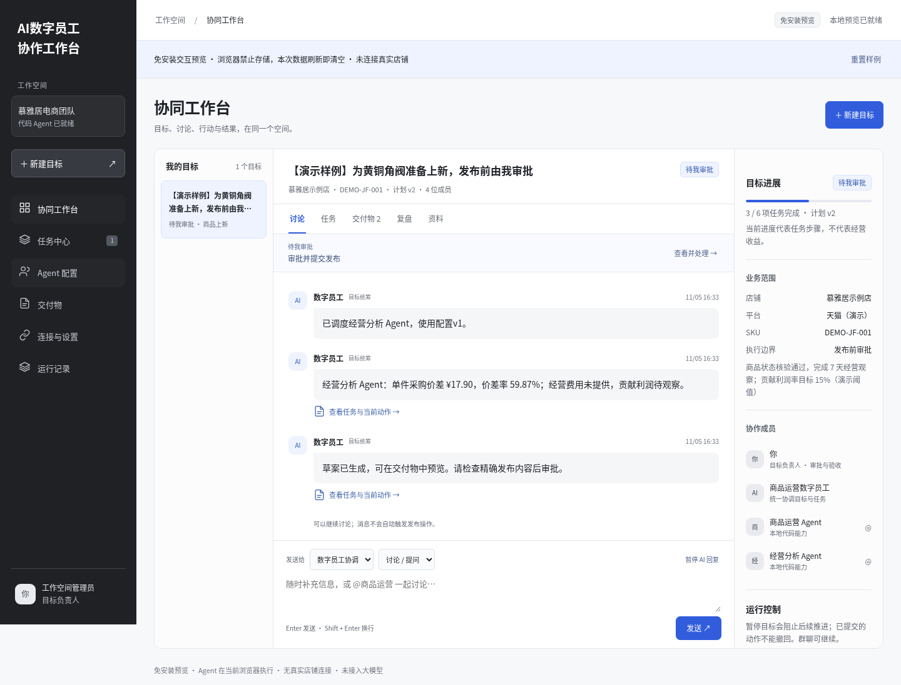

# AI数字员工协作平台 · V0.2.1

可运行的前后端基础平台：浏览器提交目标、Agent配置与业务资料；Node后端持久化、自动调度两个代码型Agent，返回真实校验和计算结果。

## 从仓库获取，不依赖聊天附件

[打开 GitHub 仓库](https://github.com/2760932471-ai/-) · [本地使用与会话说明](docs/本地使用与会话说明.md) · [项目交接与需求结论](PROJECT_CONTEXT.md)

```sh
git clone --branch main https://github.com/2760932471-ai/-.git ai-workbench
cd ai-workbench
```

也可用 GitHub Desktop 按仓库 URL 克隆。ZIP 不能在附件预览器中直接运行；云端 localhost 也不是远程预览入口。克隆后用浏览器打开 `deliverables/ai-platform-preview.html` 即可体验。

本次云端聊天不会自动进入本地 Codex / VS Code 的历史列表；`PROJECT_CONTEXT.md` 保存产品决定、实现状态和接续提示，方便新会话继续。

当前界面截图（静态图片；交互请打开上述 HTML 或启动后端）：



## 先看交互，无需安装

直接用 Chrome、Edge 或 Safari 打开 `deliverables/ai-platform-preview.html`；启动包根目录同一文件名为 `先打开预览.html`。界面、目标状态机和两个代码 Agent 与当前版本一致，可新建目标、群聊、配置测试、补录资料和查看运行记录。所有样式和脚本均已内嵌，不需要网络、Node.js 或启动服务器。

预览数据只存当前浏览器，不与完整后端同步；浏览器禁止本地存储时退回本次会话并明确提示。外部 HTTP Agent 在预览中禁用，店铺操作始终模拟。页面右上方“重置样例”只清理这份预览的数据。若聊天软件只展示 HTML 源码或静态内容，请下载后用浏览器打开。

## 启动完整前后端

要求Node.js 22+，无需第三方运行依赖：

```sh
npm start
```

在运行服务的电脑访问`http://127.0.0.1:3000`。Windows可双击`start-platform.cmd`；macOS/Linux执行`bash start-platform.sh`。自定义配置见`.env.example`；启动脚本会读取`.env`，直接`npm start`读取进程环境。

完整平台包：`deliverables/ai-platform-0.2.1.zip`。解压后可先打开 `先打开预览.html`；需要服务端持久化或外部 Agent 时，再运行启动脚本。`127.0.0.1` 只代表运行服务的电脑，不是远程预览链接。

## 本版可以实际做什么

- Agent配置：修改名称/职责、启停、阈值、超时，保存版本，测试JSON输入，查看结构化输出。
- 商品运营代码Agent：核验商品规格、来源、成本、库存与售价；根据已确认资料生成草案。
- 经营分析代码Agent：按录入账单计算贡献利润和利润率；缺资料阻塞、零销售不除0、负利润如实显示。
- 自然语言目标：规则推荐分析/上新类型，用户确认店铺和SKU；支持选Agent。
- 自动协作：确认计划后后端顺序调用必要Agent，产物关联任务与调用记录；不必逐步点击生成。
- 资料录入、缺项恢复、失败重试、暂停后恢复结果、过期结果丢弃、配置版本追踪。
- 群聊指定Agent：根据当前目标数据执行计算/校验，并回复关联原消息。
- HTTP Agent适配器：统一请求/返回契约，服务端密钥引用，域名白名单和响应校验。
- 可选工作空间访问令牌；实际店铺发布仍使用模拟连接器。

## 推荐体验

进入“Agent配置”→经营分析→运行样例测试；将销售额改成4000，成本合计2400，结果为利润1600、利润率40%。

然后新建“分析本周利润”→确认计划→等待账单→资料里录入账单→重新确认计划→查看自动生成的成果、复盘和运行记录。

上新目标邀请商品运营+经营分析，可先后得到商品校验草案及经营测算两份成果。批准发布只作用于模拟店铺，不会写入真实电商平台。

## 文档

- `docs/Agent接入与平台运行_V0.2.md`：启动、API、HTTP Agent契约、运行机制、已实现与未实现边界。
- `docs/AI数字员工协作工作台_PRD_V1.1.md`：完整产品交互需求，仍有条款未实现，不能等同本版功能清单。
- `deliverables/AI数字员工协作工作台_PRD_V1.1.html`：PRD离线阅读版。
- `docs/产品覆盖评审与设计建议_V2对照.md`：此前方案对照评审。

## 开发与验证

```sh
npm run dev
npm run check
npm test
npm run pack
```

`npm run pack`需要Python3标准库，打包源代码、说明和启动脚本，不包含.data、密钥、Git元数据或node_modules。

`npm run demo`用当前界面、目标状态机和代码 Agent 生成免安装预览；`npm run pack`会先更新预览再打包。历史 V1 单独保留在 `deliverables/历史交互原型_V1.html`。预览通过浏览器本地适配器运行，完整平台仍通过真实 HTTP API 运行。

## 结构与数据

```text
public/                 浏览器UI与HTTP交互
src/server.js           HTTP路由、静态服务、访问令牌与调度
src/platform.js         配置、目标、调用记录、事务保存与协调器
src/agents/builtins.js   商品运营/经营分析两个代码Agent
src/agents/registry.js   配置校验、HTTP适配器与返回契约
src/goals.js            目标状态机；保留旧演示兼容
src/engine.js, chat.js   旧版任务/群聊兼容代码
test/                   领域、适配器和真实HTTP/重启测试
```

新版数据保存在`.data/platform.json`，`DATA_DIR`可覆盖。首次启动读取旧goals.json为历史演示目标，旧文件保留。单进程串行JSON事务适用于当前开发版；生产多用户/多进程需要数据库、权限、队列、审计和业务执行网关。

内置Agent采用确定性规则代码；未连接LLM、真实店铺和外部Agent。HTTP适配器以可控服务响应测试，真实服务接入需配置授权域名、地址和服务端凭证。上传的慕雅居V2方案是设计依据；此前分享聊天和在线PRD资料被环境代理阻断，未将未读正文当作已核对资料。
