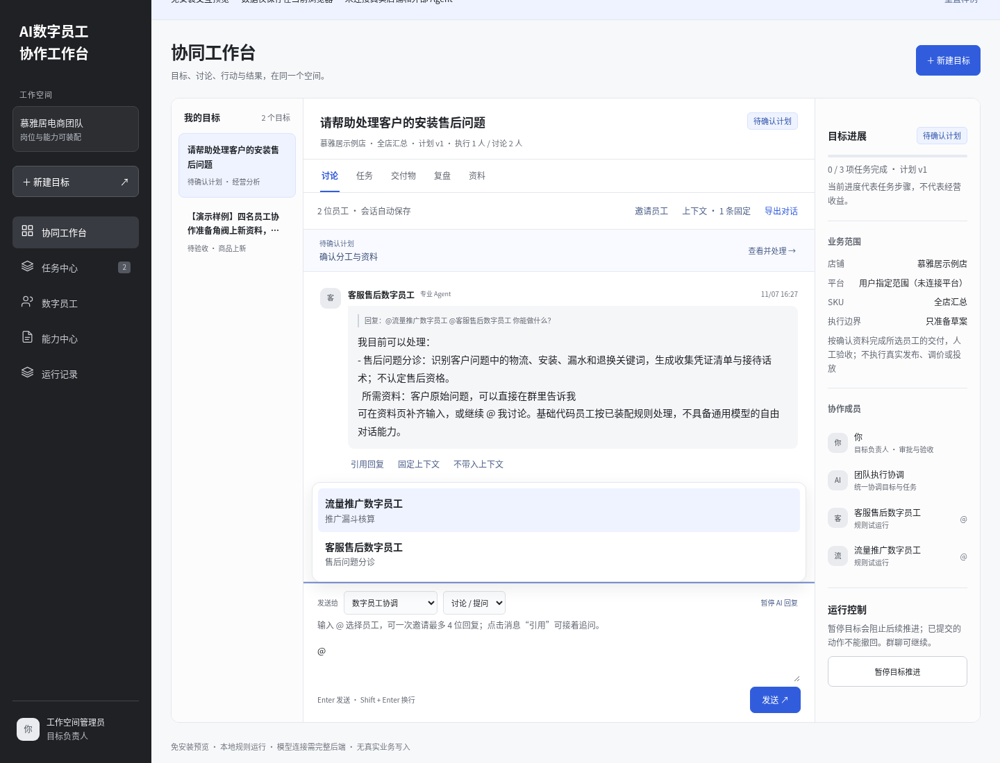

# AI数字员工协作工作台 · V0.17.1

**要真实生图，请部署完整后端：[部署与使用步骤](docs/完整平台部署与真实生图.md)。GitHub Pages 只有静态交互，不能调用 Gemini。**

V0.17.1：聊天中的明确生图指令会转为图片任务卡，带入目标和近期讨论；确认生成后回传图片交付物。连接未就绪或使用静态预览时，直接说明阻塞原因。

V0.17：新增 Gemini 原生文字生图、参考图生成和只读连接检查，保留 OpenAI Images 兼容服务。真实出图需在完整后端安全配置独立 API 密钥；GitHub Pages 仅预览交互。[Gemini 接入步骤](docs/Gemini图片接入_V0.17.md) · [企业知识与图片功能](docs/企业知识与图片生成_V0.16.md)。

V0.15 新增淘宝 / 天猫与抖店官方签名适配器：核验店铺、读取商品、逐件确认上下架、回查状态和持久化操作记录。平台选择改为卡片。适用于已有开放平台应用及店铺授权；还需在完整后端配置凭证，当前未完成真实店铺联调。**GitHub Pages 预览不会操作店铺**。从「AI基础能力配置 → 店铺连接 → 管理商品」进入，详见 [官方接入与上下架说明](docs/店铺官方接入与上下架_V0.15.md)。

V0.14 新增工作空间创建 / 切换与独立数据、知识删除与六份可导入工作指引、Tavily / 远程 MCP 搜索配置、1688 站点搜索，以及淘宝 / 天猫和抖店的店铺登记、授权网关检查与目标关联。引用操作改为图标加文字，分工卡明确显示阻塞。搜索需配置真实服务；该版本未实现原生 OAuth 和真实上下架；V0.15 已增加已有授权令牌的商品写入适配。详见 [本版交互与接入说明](docs/工作空间与搜索店铺接入_V0.14.md)，[可导入知识包](deliverables/电商数字员工通用知识包_V0.14.md)。

V0.13 调整聊天布局和引用图标，默认自动筛选上下文。选品先检索知识库及已核验供应商资料，提取有来源的报价并初筛；授权 HTTP 来源可自动同步，新增记录仍需核验。修复追问为何补资料时错误调用摘要的问题。V0.13 当时未提供网络搜索，V0.14 已补充可配置的搜索适配器。详见 [聊天与自动查找](docs/聊天与自动查找_V0.13.md)。

新建目标默认由总控自动安排成员，按目标所需能力、已装配 Skill 和配置就绪状态匹配，并展示选择依据。旧版尚未执行且未采用自定义分工的目标会自动重新匹配，无需点击改组。可随时在待确认阶段手动指定成员；开始执行后保留原分工。当前为本地规则匹配，不是模型语义规划。详见 [V0.12 总控自动匹配](docs/总控自动匹配_V0.12.md)。

按慕雅居方案V2.4建设岗位员工与能力装配：12类岗位模板、134项规划能力目录、21个可执行代码Skill、17位默认员工（12类基础岗位 + 5位内容专员）。支持真实后端持久化、群聊、团队目标、模型接入与有上限的执行循环。

**当前默认是规则试运行。模型适配已实现，但尚未用用户账号完成真实模型验证；店铺业务写入未接通。**

## 页面结构

- **工作应用**：内容制作与经营服务工作包，直接开始工作。
- **数字员工**：查看、配置员工，交目标或加入协作。
- **知识库**：文档导入、切片、召回测试。
- **AI基础能力配置**：模型连接、Skill 配置、外部 Agent、供应商资料接入与授权同步；规划目录移至“建设进度”。

协同工作台、任务中心和运行记录继续保留。手机底部显示四个常用入口与“更多”，配置、任务与运行记录从“更多”进入。旧版能力中心链接自动转到工作应用。详见 [V0.10 页面与入口调整](docs/页面结构调整_V0.10.md)。

## 先体验内容制作与新版 @

打开 **工作应用 → 内容制作**，选择商品标题、卖点、详情页文案、短视频脚本或主图设计简报。填资料、确认特点，点击生成后自动进入目标交付物；结果可查看、下载、沿用资料再做一版。本地代码编排可直接运行；其中主图设计简报交付文字；需要直接出图时，使用工作应用中的「生成主图 / 详情图」。

直接在协作聊天输入框键入 **`@`**，弹出员工候选；选择个人或 **所有员工** 后继续输入并发送。全体提及通知当前群内全部就绪员工，逐位回复；不需要操作上方接收者。支持中文紧贴、全角 `＠`、手机点击及旧会话。预览顶部 **V0.17.1** 可确认版本，无需清空数据。详见 [输入框群聊交互](docs/输入框群聊提及_V0.9.1.md)。

详见 [V0.9 内容制作、点击逻辑与异常处理](docs/内容制作与聊天修复_V0.9.md)。

## 先让员工跑起来，并在群里持续协作

“数字员工”页已提供 12 类基础员工，可以直接试运行或点击“交给他一个目标”。新增推广漏斗核算、售后问题分诊，默认不需要模型额度；旧空间补齐缺失岗位，保留已有配置。

讨论区输入 **@** 选择成员，支持一次 @ 多人；“邀请员工”可增加讨论成员，“引用回复”可连续追问。消息可以固定或排除，上下文窗口支持查看筛选依据、设置历史预算和开始新话题。

**会话有存储**：服务器版保存在 `.data/platform.json`；预览保存在当前浏览器。支持刷新恢复及导出 JSON。模型输入采用受限历史筛选，基础代码员工仍按各自规则处理，尚未接通用户真实模型。详见 [V0.8 基础员工与多轮讨论](docs/基础员工与多轮讨论_V0.8.md)。

## 总控分工与资料检查

创建目标后进入 **任务 → 总控分工**。可生成基础分工，或选择已接通模型来安排已选成员的任务、能力和交付标准。检查清楚缺项后，先采用分工，再确认执行。模型不能添加未选员工或调用未挂载能力；资料和配置变更会使旧分工失效。

群聊里问“现在进度如何、还缺什么”，协调入口直接读取状态，不重复运行计算。基础分工在免安装预览也能体验。见 [V0.7 交互与异常处理](docs/总控分工与交互_V0.7.md)。模型分工协议已实现，尚未用用户账号真实联调。

## 可直接运行的业务工作包

入口：**工作应用 → 经营与服务**。

- SKU 盈亏：上传收入费用 CSV，按实际数据输出亏损商品与费用核对清单。
- 活动折扣：录入成本、费率和预算，对比折扣利润与保本销量。
- 库存补货：上传库存、日销、交期和箱规，计算补货建议与断货风险。
- 售后答复：用本系统知识库检索政策，交付带引用的证据摘录和答复草案。

在“新建目标”输入需求后，点击 **按目标装配并推荐员工**，补齐资料并确认计划即可运行。推荐目前基于关键词和已实现能力，计算不需要模型额度。

在 **AI基础能力配置 → 外部 Agent**，支持把 **Dify Workflow / 通用 HTTP Agent** 作为员工能力挂载；仅发送所选字段，服务器密钥与当前配置协议测试通过后才能执行。适配已实现，尚未连接客户真实外部应用。见 [使用与接口说明](docs/业务能力与外部Agent_V0.6.md)，及 [商品内容](docs/agents/Dify商品内容Agent.md)、[售后政策](docs/agents/Dify售后政策Agent.md) 两份未部署的 Dify 搭建蓝图。

## 内置知识库

入口：**知识库**。直接上传 TXT / Markdown 或粘贴正文，预览并保存切片，使用 BM25 召回测试。目标可选择知识库，员工会按目标 / 提问检索并保留文档、版本与切片引用。无需外部知识库。

可配置兼容 Embedding API，实现向量与混合召回；未配置时明确禁用。当前没有客户真实 Embedding 服务联调。见 [内置知识库使用与接口说明](docs/内置知识库_V0.5.md)。

## 资料接入与选用

入口：**AI基础能力配置 → 供应商接入**。支持企业知识正文、供应商商品链接和参考图登记，以及授权 HTTP 适配接口同步。资料审核后，在目标的“资料 → 商品与参考素材”按 SKU 选用，员工交付会保留引用。

这不是已接通客户 CMS 或 1688：原生连接器、客户授权、文件解析仍待实现；图片生成已支持独立 API 接入。见 [资料来源接入与交互说明](docs/资料来源接入_V0.4.md)。

## 从这里开始

- [数字员工建设与使用说明](docs/数字员工能力建设_V0.3.md)：点击行为、异常、能力范围及模型接入。
- [项目交接与需求结论](PROJECT_CONTEXT.md)：在本地新会话继续工作的上下文。
- [本地使用说明](docs/本地使用与会话说明.md)：克隆、打开文件和聊天记录的区别。
- [网址预览部署](docs/网址预览部署.md)：GitHub Pages一次性设置。

```sh
git clone --branch main https://github.com/2760932471-ai/-.git ai-workbench
cd ai-workbench
npm start
```

Node.js 22+。规则运行无需第三方依赖；可选本机Codex接入另装官方SDK。Windows可双击`start-platform.cmd`，macOS/Linux执行`bash start-platform.sh`，启动脚本读取`.env`。默认端口3000，本机地址仅供运行服务的同一台电脑访问。

## 先体验

用浏览器打开`deliverables/ai-platform-preview.html`，或者启用仓库`gh-pages`分支的Pages站点。单文件预览内嵌样式和逻辑，可以创建员工、筛选能力、测试Skill、执行团队规则任务；不调用真实模型，数据只存当前浏览器。



推荐：数字员工 → 选择基础员工 → 新建“为角阀准备上新资料” → 填写资料 → 确认计划 → 查看员工逐步交付。能力中心会区分规划中、部分实现和已实现限定能力。

## 使用 ChatGPT Plus / Pro 订阅

订阅额度不能直接当成API余额。可在**自己的电脑**用ChatGPT登录官方Codex，再通过本平台的本机桥接调用套餐内Codex配额：

```sh
npm install -g @openai/codex
codex
npm run setup:codex
```

`codex`启动后选择 **Sign in with ChatGPT**。项目`.env`中设置`ENABLE_CODEX_LOCAL=1`和私有的`PLATFORM_TOKEN`，再用启动脚本运行服务。开启桥接后服务只绑定127.0.0.1。

进入“能力中心 → 模型连接”，添加“本机Codex”，测试通过后装配到员工。模型名可留空使用Codex默认模型。**GitHub Pages不能使用此接入；登录、额度和真实调用尚需在你本机验证。**

另一条路线是配置OpenAI兼容API的HTTPS地址、模型标识和服务器密钥变量名，使用独立API额度。两种方式都不需要在聊天中发送密钥或账号凭证。

## 运行机制与限制

- 新建目标保留自然语言输入、成员选择和范围确认；业务类型推荐仍为关键词规则。
- 团队成员按用户确认的分工顺序交接成果；总控可生成受限分工，模型员工内部选择本步骤授权的 Skill，尚不支持自主扩编和动态任务分支。
- 所有内置Skill只读输入；外部应用必须由管理员核验为只读。模型不能任意联网、执行代码、覆盖输入事实或发布商品。
- 缺资料等待补录，失败可重试，旧版本结果丢弃，运行记录保存输入、配置版本、轨迹与成果。
- 角色权限、多用户、事件感知、真实业务连接与完整方案仍待建设。
- `.data/platform.json`原子保存，适用于当前单进程开发版；运行数据和`.env`不提交Git。

## 开发与发布

```sh
npm run check
npm test
npm run demo
npm run pack
npm run deploy:preview
```

`demo`更新当前预览；`pack`需要Python3并生成`deliverables/ai-platform-0.17.1.zip`；`deploy:preview`只向gh-pages发布HTML及.nojekyll。推送成功不等于Pages站点已经构建上线。

`src/workforce/`包含能力目录、Skill、员工配置、模型/API/Codex适配、执行循环与团队任务。`public/workforce.js`为员工和能力中心界面。旧版规则与模拟发布保留兼容，V0.2说明及PRD中未实现条款不能当作本版已交付能力。
