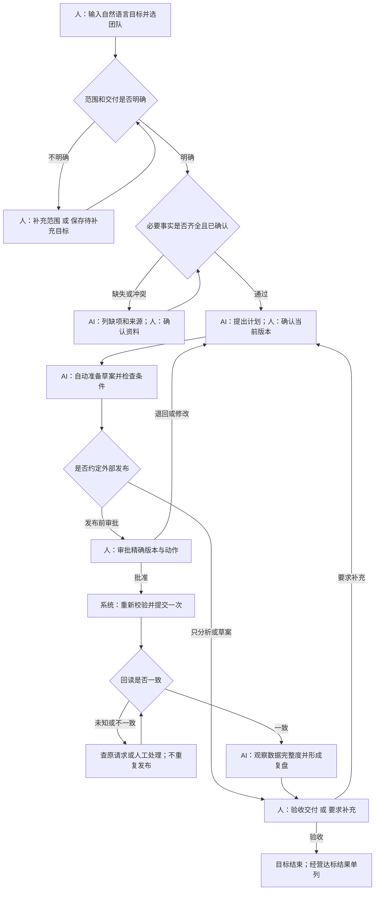

# AI数字员工协作工作台 PRD V1.1

**文档类型：功能与交互规格。** 面向产品、设计、开发和测试，用于回答“在什么状态下，谁点什么，系统做什么，成功后去哪，失败后如何继续”。

| 项目 | 说明 |
| --- | --- |
| 版本 / 日期 | V1.1 / 2026-11-05（北京时间） |
| 适用产品 | AI数字员工协作工作台：自然语言目标 + 人类/AI群聊 + 结构化任务 |
| 本次变更 | 重写V1.0的功能逻辑，补充条件分支、动作权限、状态、异常恢复、可执行验收用例 |
| 需求依据 | 用户当前会话、《慕雅居AI电商数字员工解决方案_V2.0.md》及当前原型代码 |
| 线上参考核验 | 搜索及候选资料页均被代理403拦截，未读取正文；见[检索记录](research/PRD公开资料检索记录_2026-11-05.md) |
| 实现状态 | 本文定义下一版应达到的行为，**不是现有原型全部已实现的声明**；差异见第17节 |
| 本轮交付 | 重写PRD与验收规格；不把文档新增要求自动算作代码已修改 |

## 阅读导航

- 产品怎么运行：第1–3节。
- 每个入口、按钮、弹窗的具体行为：第4–13节。
- 失败、超时、重复操作怎么处理：第14节。
- 直接用于开发联调和测试的完整场景：第15节。
- 当前原型哪里不符合新规格：第17节。

规格标记：**【已有】** 当前原型有主要交互，仍需按条款核对细节；**【需补齐】** 下一版原型要补的交互或规则；**【接入期】** 依赖真实模型、平台、成员或数据后实现。一个功能中三者可同时存在，逐条注明。

---

## 1. 产品工作方式与本期范围

### 1.1 用户交代目标，系统负责推进

用户输入“把这款角阀上架，先确认参数和文案，发布前让我审批”。产品要完成的事是：明确店铺和SKU → 补齐商品事实 → 形成并确认计划 → 数字员工推进准备工作 → 必要时请求审批 → 执行后验证 → 观察与验收。

**人必须参与的节点：** 目标范围存在歧义、权威资料缺失/冲突、计划首次确认、影响范围变化、需要授权的外部动作、异常无法自动恢复、最终验收。

**系统应自动推进的节点：** 已确认范围内的只读查询、已授权的草案生成、按计划调度能力、记录产物、检查依赖、等待条件满足后的恢复、查询平台回执。用户不应为每个内部步骤反复点“下一步”。

当前原型“确认计划→点击生成草案→批准→点击模拟提交→点击模拟回读”的手动流程只用于演示。下一版应增加自动推进演示，并把故障注入按钮放进“演示控制”，不混进运营人员的日常主操作。【需补齐】

### 1.2 一眼看懂人和AI在哪里交接

图中的“系统自动”指本规格的目标行为。当前原型主要是按钮驱动的模拟，差异在第17节单列。

### 1.3 这期先定义三种结果，不把所有目标套成上架

| 路径 | 用户的目标 | 到哪一步算交付完成 | 不应出现 |
| --- | --- | --- | --- |
| A 经营分析 | 找问题、出分析或建议 | 有来源、限制和建议的交付物，经人验收 | 商品发布/调价审批 |
| B 上新草案 | 准备商品参数、文案与发布草案 | 已确认规格的上新草案，经人验收 | 发布执行、平台上架成功状态 |
| C 上新并观察 | 准备并在授权后上新，观察经营结果 | 动作核验、完整观察与最终复盘验收 | 只回复几句建议就自动“目标完成” |

一期默认采用安全可核对的“准备草案”边界，用户在目标确认页明确选择“发布前逐次审批”才能进入C路径。【需补齐：当前原型上新默认选发布审批】

持续经营、自动发现机会、多平台、多SKU批量操作属于后续阶段。当前原型的机会卡必须标“机会样例”，不宣称自主监测已上线。

### 1.4 完成、达标、关闭是三个不同结论

- **任务完成：** 该任务达到自己的验收条件，例如发布回读匹配。
- **目标验收完成：** 人类负责人接受本次约定的交付；业务阈值不达标也允许如实结束。
- **经营达标：** 观察数据完整且达到创建时约定的业务指标；单独显示“达标/未达标/无法判断”。
- **目标终止：** 用户不再继续；需要记录原因和已产生的外部影响，不能伪装成全部任务成功。

### 1.5 核心对象的分工

| 对象 | 用户如何理解 | 与其他对象的关系 |
| --- | --- | --- |
| 目标 | 我要达成什么、范围是什么、如何验收 | 一目标有一协作空间，可有多任务 |
| 协作空间/群 | 围绕这个目标说话、解释、补充和决策 | 对话只是入口，不代替任务状态 |
| 任务 | 谁负责哪一步、依赖谁、是否阻塞 | 有明确输入和完成标准，可有多次执行尝试 |
| 执行尝试 | 一次实际的能力或工具调用 | 失败重试创建新尝试，但不得无理由创建新目标 |
| 交付物 | 可预览、使用和验收的成果 | 属于任务，保留版本；不是每句回复都算成果 |
| 审批 | 针对某版本、某范围的一次授权 | 不授权整个群未来的一切操作 |
| 商品事实 | 材质、接口、库存等有来源的资料 | 聊天建议不能直接覆盖已确认事实 |

## 2. 页面、入口与角色

### 2.1 页面地图

| 页面ID | 名称 / 入口 | 页面主操作 | 点击后到哪里 |
| --- | --- | --- | --- |
| P01 | 协同工作台 / 默认首页 | 新建目标；选择已有目标 | 创建弹窗P02或当前目标P04 |
| P02 | 新建目标·第一步 / 全局“新建目标” | 输入目标、确认类型、选择Agent | 下一步到P03；关闭回原页面 |
| P03 | 新建目标·第二步 / 确认范围 | 确认店铺、SKU、边界和验收条件 | 成功创建后进入P04讨论 |
| P04 | 目标工作区 / 左侧目标列表 | 切换讨论、任务、交付物、复盘、资料 | 目标不变，标签和内容变化 |
| P05 | 商品资料 / 目标资料标签或缺资料卡 | 提交资料、核对、确认 | 资料完整后，目标进入待确认计划 |
| P06 | 执行计划 / 目标任务标签 | 确认/调整计划，处理阻塞 | 自动开始可执行任务或停在等待项 |
| P07 | 交付物预览 / 成果卡 | 预览、反馈、下载 | 关闭返回打开前位置 |
| P08 | 执行审批 / 群审批卡或待我处理 | 批准、退回、修改内容 | 进入提交/重新计划/变更确认 |
| P09 | 执行详情 / 任务或回执卡 | 查看提交和回读、异常恢复 | 返回原目标，不另建任务 |
| P10 | 复盘验收 / 目标复盘标签 | 查看结果、要求补充、验收、下一轮 | 保持当前目标或创建新目标草稿 |
| P11 | 全局任务中心 / 一级导航 | 筛选待我处理，打开任务 | 回到对应目标的具体任务 |
| P12 | 全局交付物 / 一级导航 | 筛选、预览、打开目标 | 同一份成果，不复制产物 |
| P13 | 数字员工 / 一级导航 | 看岗位和能力、邀请到新目标 | 打开预选该Agent的创建草稿 |
| P14 | 连接与设置 / 一级导航 | 查看能力可用性、配置授权 | 权限允许时进入连接配置；当前演示只展示状态 |

桌面：目标列表 / 主工作区 / 目标详情三列。手机：目标列表横向滚动；主工作区保留五个标签；右侧信息通过“目标详情”打开，返回后保持原标签和草稿。【已有】

### 2.2 角色与操作权限

| 动作 | 目标负责人 | 协作者 | 指定审批人 | 只读成员 | 数字员工 |
| --- | --- | --- | --- | --- | --- |
| 阅读目标/资料/成果 | 在授权范围内 | 在授权范围内 | 审批所需范围 | 在授权范围内 | 本目标授权上下文 |
| 发消息/提交补充资料 | 可 | 可 | 有协作权限时可 | 不可 | 可生成建议/请求 |
| 确认范围和计划 | 可 | 不可，提出建议 | 兼有负责人身份才可 | 不可 | 提议，不代替确认 |
| 确认商品事实 | 有该资料确认权限才可 | 被指定且有权限才可 | 不自动获得 | 不可 | 引用，不自证真伪 |
| 批准外部动作 | 同时被指定为审批人时可 | 不可 | 可批准本人范围 | 不可 | 不可自批 |
| 暂停/恢复/终止目标 | 可 | 不可，可申请 | 不自动获得 | 不可 | 可因异常阻塞，不代替用户终止 |
| 验收目标 | 可 | 不可，提供反馈 | 不自动获得 | 不可 | 提交复盘，不自验收 |

当前原型只有“你”一个人类身份，暂代负责人、资料确认人和审批人；这是演示身份合并，真实权限矩阵在接入期实施。无权操作显示禁用及原因，例如“仅指定审批人可批准”，服务端仍需校验，不能只隐藏按钮。

## 3. 通用交互与状态规则

### 3.1 所有修改操作共同遵守

| 规则ID | 条件 | 产品行为 |
| --- | --- | --- |
| G01 | 用户点击会保存数据的按钮 | 立即改为进行中，如“正在创建…”；同一动作不能再次提交；只冻结相关表单，不冻结其他目标的聊天 |
| G02 | 服务端明确成功 | 同步对象、状态、卡片和计数；显示具体结果，例如“计划v2已确认，开始准备草案”；不只提示“操作已记录” |
| G03 | 明确失败且未产生副作用 | 恢复按钮，保留输入，在操作位置显示原因和可执行下一步；不跳页面、不清空表单 |
| G04 | 超时/断网，是否成功未知 | 显示“结果确认中”，按同一请求编号查状态；在查清前不创建新请求、不自动再发布 |
| G05 | 重复点击或网络重发 | 同一业务请求返回同一个结果；幂等有效期至少覆盖该业务操作的完整生命周期，不能仅靠按钮disabled |
| G06 | 当前版本已被他人改变 | 拒绝旧动作，显示“内容已更新，请检查最新版本”；保留用户草稿，展示差异，不能静默覆盖 |
| G07 | 请求进行中时切换目标/导航 | 已提交操作继续；完成后只更新归属目标；给结果提醒但不强行跳回；原草稿保留 |
| G08 | 关闭弹窗前有未保存改动 | 询问“保留草稿 / 放弃修改 / 继续编辑”；点击遮罩不关闭；Escape与关闭按钮遵守相同规则 |
| G09 | 请求进行中时关闭弹窗 | 关闭/返回按钮暂时禁用，Escape不关闭；提示“正在确认提交结果”；刷新或离开整页不视为取消，回来后查询原请求；结果明确后恢复关闭 |
| G10 | 目标/消息列表为空 | 说明为什么为空，并给可执行入口；筛选无结果给“清除筛选”，不能把它写成“没有任何任务” |
| G11 | 刷新、轮询或推送到来 | 不能丢草稿、抢焦点、重置选区；读历史时只显示“有N条新消息”，点击后才到最新 |
| G12 | 后台数据尚未可用 | 使用“未提供/未接入/等待更新”，不当作0；演示数据和真实数据不可合并成真实经营结果 |

G01–G03/G07/G11当前只部分具备，G04–G06/G08–G09需补齐；不能因为本地演示响应快就省略加载和失败态。

**原型演示时间约定：** 点击后立即反馈；模拟异步步骤显示约1秒执行中。真实交互若2秒仍未返回显示进度说明；10秒仍未返回显示“耗时较长，可稍后查看”；30秒转“查询结果中”，仍不直接判定外部动作失败。以上为拟定UX默认值，可配置，不是外部接口SLA。

### 3.2 目标状态和任务状态分开

目标阶段表示整个目标卡在哪里；每项任务有自己的状态；暂停是覆盖状态，必须保存暂停前阶段。

| 目标阶段 | 进入条件 | 用户看到的主动作 | 离开条件 |
| --- | --- | --- | --- |
| 待补充范围 | 已建目标但关键店铺/SKU/完成标准未确认 | 补充目标信息 | 用户确认必需范围 |
| 等待资料 | 必需事实缺失、冲突或未确认 | 补充/确认资料 | 所有本阶段必需事实通过核验 |
| 待确认计划 | 新计划或影响范围的新版本已生成 | 确认计划 / 修改计划 | 负责人明确确认当前计划 |
| 执行中 | 计划已确认且至少一项可执行 | 查看进度 / 暂停目标 | 遇资料、审批、异常或全部任务完成 |
| 待审批 | 已形成确切外部动作且需要人授权 | 查看并审批 | 当前动作获批、被退回或失效 |
| 待提交/提交中 | 动作获批，正在二次校验并提交 | 查看执行详情 | 获得提交结果；不再出现重复发布按钮 |
| 待核验 | 已提交或提交结果不确定 | 查看核验进度 | 明确匹配、拒绝、差异或超时升级 |
| 观察中 | 发布核验通过且还需业务观察 | 查看已采集数据 | 窗口完整且数据质量通过 |
| 待验收 | 达到本路径的可验收交付条件 | 查看成果并验收 | 负责人验收或要求补充 |
| 异常待处理 | 自动恢复耗尽或需人决策 | 查看具体异常 / 人工接管 | 问题已处理且重校验通过 |
| 已结束 | 负责人验收 | 查看历史 / 创建下一轮 | 原目标不重开执行 |
| 已终止 | 终止流程确认且外部影响已列清 | 查看终止结果 | 原目标不重开执行 |

暂停时展示“已暂停 · 原阶段：待审批”等。恢复回原阶段，重新验证执行条件；不把暂停转换成完成。当前原型缺少部分阶段，映射和待补齐见第17节。

任务状态：待开始、等待依赖、待确认、执行中、等待资料、待审批、待核验、观察中、待验收、异常、已完成、已取消。后续依赖任务只显示“等待T03完成”，不得同时运行或错误记为失败。

### 3.3 自动推进的判断顺序

每次确认、消息、工具返回或定时事件到来，协调者按顺序判断：

1. 目标已结束/终止？只记录讨论，不再执行。
2. 目标已暂停？记录事件并保存检查点，不启动新业务动作。
3. 当前任务输入缺失、冲突或过期？生成/更新同一缺资料卡，等待。
4. 计划是否需要重新确认？生成当前版本计划卡，等待。
5. 是否将发生需授权的外部动作？生成精确审批，等待；已有审批还要检查版本和授权有效性。
6. 权限、能力和业务约束是否可用？不可用时阻塞并说明原因；不自动换成未经允许的工具。
7. 执行一个可运行步骤，保存结果和证据，再重新判断；不以“所有Agent都发过言”作为推进条件。

只读重试和同一版本的回执查询可自动进行。发布、调价、预算变更的未知结果不能盲重试。UI显示行动摘要与依据，不暴露内部推理过程。

---

## 4. F01 新建目标：从点击入口到建立协作空间

**当前：** 两步弹窗、自然语言输入、选Agent、演示范围及三条模板路径已有。目标澄清、可编辑真实范围、草稿保留和请求恢复需补齐。

### 4.1 首次点击及字段

入口：侧栏/手机页头“新建目标”、空工作台“新建你的第一个目标”、机会样例“用这个样例新建目标”、数字员工页“邀请到新目标”、已结束目标“创建下一轮优化目标”。

| 入口 | 初始内容 | 不应发生 |
| --- | --- | --- |
| 全局新建 | 空描述；显示上次未完成草稿的恢复入口 | 不自动建立空目标 |
| 机会样例 | 预填上新描述；保留来源卡ID及“演示”标记 | 不把样例标为实时发现 |
| 邀请Agent | 预选该Agent，用户仍可增删 | 不直接执行该Agent |
| 下一轮优化 | 预填上一轮结论摘要、来源目标链接；默认分析 | 不继承旧发布审批、旧执行权限或旧观察成功状态 |

第一步字段：

| 字段 | 默认 / 必填 | 校验与处理 |
| --- | --- | --- |
| 目标描述 | 空 / 必填 | 去首尾空白后1–2000字；纯空格无效；多行允许；显示字数；超限阻止下一步，不静默截掉粘贴内容 |
| 协作类型 | 根据模板预填，可修改 | 原型用明确的分析/上新模板；真实AI解析失败时保留原文供用户选择，不能默默套上新 |
| 负责数字员工 | 随类型推荐 | 上新→商品运营；分析→经营分析；说明其对目标负责，与下方专长成员不是两个重复任务负责人 |
| 协作Agent | 常规入口按模板推荐；专属入口仅预选该Agent | 至少1个可用成员；不可用项说明原因；缺少必要能力时提示补充，不能默默交给列表第一人 |

### 4.2 “下一步：确认范围”操作规格

| 步骤 | 用户操作/条件 | 系统处理 | 页面结果/文案 |
| --- | --- | --- | --- |
| 1 | 点击下一步 | 先校验描述与团队 | 不合格则停留P02，错误在对应字段下；焦点到首个错误 |
| 2 | 本地演示且输入有效 | 按用户确认的模板组织范围 | 进入P03，注明“演示模板，不代表AI已理解全部需求” |
| 3 | 真实模型已接入 | 整理目标、范围、验收条件和能力需求 | 按钮“正在整理目标…”；保留原输入 |
| 4 | 用户只说“帮我赚钱”等模糊目标 | 追问具体店铺、问题及交付，保留已知项 | 显示简短问题与可选答案，不能凭空挑SKU或许诺收益 |
| 5 | 描述包含多个不相关任务/多个SKU | 提示“本次试点只支持一个范围”，让用户选择本次目标 | 未选清前不能启动业务执行；未来批量方案另行设计 |
| 6 | 用户选择暂时不补充 | 可“先创建，稍后补充” | 创建待补充范围目标，仅允许讨论/补信息，不生成可发布草案 |
| 7 | 模型整理失败或超时 | 保留原文与成员，允许重试或切换手动范围确认 | “暂时无法整理目标，你可以手动确认范围” |

第3–7步真实语义处理属于接入期；下一版原型需能用情景数据演示缺信息和多意图分支，而不是始终直接给固定SKU。

### 4.3 第二步字段与条件分支

| 字段 | 分析路径A | 草案路径B | 上新路径C |
| --- | --- | --- | --- |
| 平台/店铺 | 一个已授权店铺或演示店 | 同左 | 同左，执行授权必须有效 |
| 商品范围 | 全店汇总或明确SKU | 一个明确SKU | 一个明确SKU |
| 预期交付 | 分析问题、期间、成果类型 | 规格+内容草案 | 发布状态验证+观察复盘 |
| 执行边界 | 固定只分析，解释原因 | 只准备草案，默认 | 用户显式切换“发布前逐次审批” |
| 观察周期 | 分析数据期间 | 不出现经营观察必填项 | 7天示例，可按试点设定 |
| 验收标准 | 建议有来源、限制与结论 | 规格有来源、草案完整 | 动作匹配+观察完整；经营阈值单独记录 |
| 资料准备度 | 显示真实数据是否接入 | 缺事实不阻止建立目标，但阻止草案执行 | 同左 |

切换执行边界时同步修改路径预览、交付标准、任务数与按钮说明。选择只准备草案后，页面不得仍写“审批发布后观察7天”。返回第一步保留第二步已编辑信息；改成不兼容类型时提示哪些字段将重置，用户确认后只清不适用字段。

范围未确认完整时，“创建目标并进入协作”禁用并列出缺项；另提供“先创建待补充目标”。后者只创建澄清任务和讨论空间，不生成可执行发布计划，待用户补齐后再进入资料/计划路径。

原型仅演示店铺与SKU，不伪造真实下拉选项。真实范围接口不可用时显示未连接，不用演示数据顶替。

### 4.4 “创建目标并进入协作”操作规格

1. 重校验描述、成员、范围、边界；前端通过后，服务端再次校验。
2. 生成本次创建请求编号；按钮变“正在创建…”。同一请求只允许建立一个Goal。
3. 一次性保存Goal、协作空间、目标首条消息、初始计划/缺资料任务及关联关系。
4. 全部保存成功才关闭弹窗、清除创建草稿、进入新目标讨论页。新目标置顶，任务中心同步出现任务；顶部显示当前阻塞与下一步。
5. 缺范围→待补充范围；上新缺事实→等待资料；分析范围完整→准备计划。成功提示要指出“目标已创建，等待确认商品资料”等具体状态。
6. 数据保存失败则整个创建不生效；不能出现“群有了、任务没有”的半成功。
7. 创建响应丢失则查同一请求编号：查到目标直接进入；确认未创建才允许原请求重试。无法确定则显示“创建结果待确认”，不让用户重复新建。

**验收F01：** 用户连续点击创建两次、或第一次已创建但响应被截断，最终目标列表只有一个目标，群和任务只关联这一个目标。

## 5. F02 打开、切换目标及信息保持

| 操作/条件 | 系统与页面变化 | 异常与恢复 |
| --- | --- | --- |
| 点左侧目标 | 切到该目标，恢复该目标上次标签；首次默认讨论；右侧范围同步 | 加载中显示骨架；失败停在目标框架内显示重试，不混入上一目标数据 |
| 点讨论/任务/交付物/复盘/资料 | 只切标签，目标ID不变 | 每标签加载失败可单独重试，不使整个群不可用 |
| 从任务中心打开任务 | 打开关联目标的任务标签，定位具体任务并高亮一次 | 任务已结束也可看历史；失去权限显示无权访问，不回退到其他人的目标 |
| 从成果打开目标 | 打开所属目标的交付物标签，定位同一版本 | 文件已替代仍可看历史，标注最新版本链接 |
| 手机点目标详情 | 在当前工作区打开范围、成员、运行控制 | 返回恢复标签、输入和滚动；不当作导航到新目标 |
| 收到其他目标的新消息 | 更新未读数和待办，不抢当前页面 | 用户主动点提醒才跳转 |
| 当前目标有消息更新且正在读历史 | 当前位置不动，显示“有N条新消息” | 点击提示滚到最新，并清除相应未读计数 |

草稿按用户+目标保存；接入期服务端草稿跨设备同步，原型可本地保存。创建草稿默认保存7天并显示更新时间；群消息未发送文本在同一浏览器刷新后恢复。退出登录清理本地可读缓存。当前原型群草稿仅页面内存保存，刷新保留需补齐，不得把目标持久化等同于草稿持久化。

## 6. F03 群聊：人类发言如何影响Agent和任务

### 6.1 默认交互

群输入框默认“交给数字员工协调”，用户不必每次选择意图或猜该叫谁。现有“讨论/补充背景/请求变更”选择器可作为演示辅助，实际产品应由系统识别并在不确定时追问。涉及业务状态变更仍需明确确认卡。【需补齐/接入期】

发送按钮：空白内容禁用；有效消息可发送。Enter发送、Shift+Enter换行；中文输入法选词时Enter不发送。发送文本上限2000字；文字按纯文本显示，不执行HTML或脚本。

### 6.2 从发送到收到回复

| 阶段 | 用户看到什么 | 系统行为 | 失败处理 |
| --- | --- | --- | --- |
| 点击发送 | 人类消息气泡先显示“发送中” | 用稳定消息ID提交；旧草稿只在保存成功后清除 | 明确失败显示“未发送·重试”，文本可编辑或复制 |
| 消息已保存 | 气泡显示时间；输入框可继续输入 | 创建一个协调任务或定向回复任务 | 回复失败不撤销人类消息，不让用户重复发送原文 |
| 等待AI | “数字员工正在处理”及可见任务摘要 | 对消息做意图/范围判断，按需调用能力 | 超时转失败提示，不无限转圈 |
| 已有回复 | 回复关联原消息；显示发言者和依据 | 有明确产出时才挂成果卡 | 不能把每条回答自动归档为草案 |
| 响应未知 | 气泡显示“确认发送结果中” | 按消息ID查是否已保存 | 查到后标已发送；未查清不生成新消息ID重发 |

用户在请求过程中继续输入的新文字必须保留。发送队列达到原型24项上限时先拦截，不插入已发送消息，输入框下显示“待处理消息较多，请稍后发送”，保留文本。其他目标不受影响。

### 6.3 语义与业务处理决策表

| 消息场景 | 示例 | 主协调者必须做什么 | 会不会改变任务/审批 |
| --- | --- | --- | --- |
| 问当前进展 | “现在卡在哪里？” | 返回当前任务、阻塞原因、下一位处理人及入口 | 不改状态 |
| 普通讨论 | “标题能不能更简洁？” | 回答并给建议，必要时产出备选 | 不直接改已审批标题 |
| 补充背景 | “这款主要面对装修客户” | 保存背景并说明适用范围 | 不覆盖商品权威字段 |
| 补充事实 | “接口是G1/2，这里有规格表” | 建立待核验资料项，提示有权限的人确认 | 确认前不变事实快照 |
| 明确改约束 | “价格改成32.90” | 生成变更确认卡，列旧值、新值、影响任务及审批 | 用户确认后才升版并使受影响审批失效 |
| 要求执行 | “直接发吧”/“好的” | 指向当前精确动作审批卡；说明当前未授权或已授权状态 | 普通文字不当作审批 |
| 提出新任务 | “另外分析一下退款” | 问“加入当前目标计划 / 新建目标”；给范围影响 | 选前不偷偷扩范围，选后形成可确认计划 |
| 与本目标无关 | “帮我做另一个店铺活动” | 提议另建目标，并预填新建草稿 | 不混用当前店铺授权 |
| 多意图 | “改价格，再发，上周数据也看看” | 拆成待确认的变更与分析请求；说明发布需重新审批 | 不因为一句话连做多次写操作 |
| 信息矛盾 | 聊天说铜，资料卡写不锈钢 | 显示冲突字段、两份来源和核验入口 | 阻塞受影响任务，不擅自选一个 |
| 紧急停止 | “先别发”“暂停这个目标” | 展示并执行明确的暂停目标确认；优先阻止未提交写操作 | 暂停业务推进；已提交动作仍需查结果 |

接入期自动识别只生成建议或候选命令，最终写操作仍经过状态/权限/版本校验。自然语言中的“暂停目标”若意图置信不足，立即阻止新的外部写操作并要求确认，而不是继续发布。

### 6.4 @和协作成员路由

- 点成员头像旁的@：回到讨论、选择该成员、聚焦输入框；不自动发送空消息。【已有】
- 输入@显示当前可见成员候选，选择后形成明确成员引用。【需补齐：当前只是文本匹配】
- 只@一个有效成员：只创建该成员的一次回复请求；主协调者仍跟踪结果，不让全部Agent各说一遍。
- @多个成员：先由协调者按问题拆分邀请，避免循环互相触发；每成员最多一个该轮子请求；可无须发言的成员不发言。
- 输入@A但下拉明确选B：发送前提示冲突，让用户选“A / B / 交给数字员工协调”，不得按成员数组顺序暗中取第一个。
- @未加入或不可用成员：提示“该成员不在当前目标中/暂不可用”，允许改接收者或请求邀请；不静默伪装为该成员回复。
- 自动协作回复不会再触发无限自动回复；每轮有预算/步数上限，到上限说明已完成部分和待处理项。

### 6.5 AI回复失败

已保存人类消息保留。回复区域显示“内容营销暂时未能完成回复”，提供“重试此回复”“交给数字员工协调”；仅重试该子请求，不重发全群、不重复生成已完成成果。对无效资料、权限不足等业务错误不自动重试；临时网络错误可自动重试一次，仍失败交人处理。真实重试次数和费用预算在连接设置配置；原型用可见情景模拟。

## 7. F04 商品资料：缺什么、谁补、何时能继续

### 7.1 进入与展示

创建上新目标后，若缺必需资料，讨论区出现“还缺3项资料”的卡片，列字段、影响任务、处理人和“去补充”。卡片与任务标签的等待资料条目是同一项，不重复建单。点击到P05，定位首个缺字段。

资料表字段：商品名称、内部SKU、平台SKU映射（有则显示）、材质、规格/尺寸、接口/适用条件、成本、库存、售价草案、来源文件/记录、数据更新时间、确认人/时间。必需字段随品类模板确定，非所有商品都强制存在接口。

### 7.2 字段与确认规则

| 项 | 可接受内容 | 缺失/冲突时怎么办 |
| --- | --- | --- |
| SKU与店铺 | 选定业务范围内的确定映射 | 无映射则阻止发布；可继续准备不含事实断言的提纲 |
| 材质/尺寸/接口 | 权威资料中可追溯字段及单位 | 不准用AI补全；标记待确认；展示原文位置 |
| 成本 | ≥0的金额及币种、口径、更新时间 | 未知不按0处理；无法算利润则显示不可判断 |
| 库存 | 非负整数及来源时间 | 库存不足/过期时阻止发布或承诺供货；请求更新 |
| 售价草案 | 正数、币种一致；人民币最多2位小数 | 不符合精度/上下界时字段报错；UI校验不能替代业务最低价策略 |
| 资料来源 | 有可查看记录或文件 | 无来源只能为“用户陈述待核验”，不能一键变权威事实 |

“确认资料”按钮只在当前必需项填写且无未解决冲突时可点。禁用旁列“缺少：接口来源、成本口径”等原因，不能只变灰。

### 7.3 操作与状态变化

| 用户操作 | 系统处理 | 成功后的页面与任务变化 | 异常 |
| --- | --- | --- | --- |
| 上传/关联资料【接入期】 | 校验文件类型/大小；解析并抽取为候选字段，不自动确认 | 显示“原值/候选值/来源”对照 | 上传失败保留原记录；解析失败可手填并保留附件，不谎称解析成功 |
| 保存未完整资料 | 保存已填内容，标“待补齐” | 返回后可继续编辑；任务仍等待资料 | 不能因部分保存而推进发布 |
| 点击确认资料 | 检查权限、必需项、来源冲突及当前版本 | 保存事实版本、确认人时间；更新缺资料卡；条件满足后准备计划 | 并发修改则展示差异，需重新确认 |
| 原型“载入演示资料” | 先展示即将载入的虚构值与来源 | 用户明确确认后写入样例事实；全程保留演示标记 | 不把这一步包装成真实上传或ERP同步 |
| 修改已确认资料 | 展示影响范围，如标题、适配说明、审批 | 形成事实新版本，旧版保留；失效依赖旧值的草案和审批 | 执行已提交时不改原执行快照，按变更规则处理 |

对售价、库存、授权等执行关键数据，发布前须重新校验当前状态；超过连接器声明的数据时效则先刷新。当前原型样例资料无真实时效，不应用于真实判断。

**验收F04：** “材质待核验”时不能生成宣称“全铜”的可发布草案；用户确认来源后才能生成；随后材质变化，旧批准不能继续使用。

## 8. F05 计划确认、自动执行与Agent调度

### 8.1 计划必须让人看懂什么

每项任务至少展示：任务名称、负责岗位/成员、所需输入、前置任务、预计产物、完成标准、是否涉及外部写入、是否需要人审批。不以“调用tool_xxx”作为业务任务标题。

例：

| 顺序 | 任务 | 依赖 | 完成标准 | 人/AI如何参与 |
| --- | --- | --- | --- | --- |
| T01 | 核验商品事实 | 已确定SKU | 必需规格与成本库存有来源且确认 | 人确认，AI整理冲突 |
| T02 | 准备上新内容 | T01、计划已确认 | 标题、参数、详情内容与事实一致，生成草案版本 | AI自动准备 |
| T03 | 检查草案及发布条件 | T02 | 内容/权限/库存校验通过，精确动作可展示 | AI检查，必要时请人补充 |
| T04 | 发布审批与提交 | T03 | 当前版本获批，提交结果明确 | 人审批，系统提交 |
| T05 | 核验平台状态 | T04 | 店铺/SKU/内容/价格/可售状态匹配 | 系统回读，异常升级 |
| T06 | 观察并形成复盘 | T05 | 窗口完整、费用完整、达标结论有依据 | 系统采集，人验收 |

计划本身是管理节点，不必把“确认计划”当作一项产生经营价值的产物。当前原型保留此任务节点用于展示，下一版可在计划卡表达。

### 8.2 点“确认计划”之后

前置：负责人有权确认；关键范围已确定；计划版本与页面一致；目标未暂停/终止。

1. 点击后按钮变“正在确认…”，服务端记录确认版本。
2. 成功后计划卡显示“v1已确认”，用户仍留在当前标签；当前可执行任务变执行中，其余等待依赖。
3. 讨论中出现简短事件卡：“计划已确认，内容营销开始准备草案”。右侧进度、全局任务同步。
4. 主协调者自动调用所选能力，按依赖消费结果；普通草案准备不再要求用户额外点“生成”。
5. 遇到需要人输入的条件，停止受影响步骤，显示“需要你补充…”；其他无依赖且安全的步骤可继续。
6. 当前原型为串行演示，不宣称已实现任务并行；专业Agent是按需调用，不是每位必须轮流发言。

### 8.3 修改计划

点“修改计划”打开编辑侧栏，保留当前已确认版本。可改交付要求、任务安排或参与能力；不能通过编辑删除必要的发布核验/审批控制。点取消不影响旧计划；点“确认变更”展示变更前后、受影响产物和需要重批的动作，然后保存新版本。

已执行成功且与变更无关的任务不重做；受影响的未执行任务等待新计划确认。版本变更不应把真实已上架商品恢复为“未发布”。

### 8.4 能力不可用、失败与部分成功

- 缺少必要能力：计划卡显示“缺少商品事实校验能力”，给“补充能力 / 改为人工处理 / 调整目标”。不得自动将关键任务派给无关的客户服务Agent。
- 一项只读步骤临时失败：显示失败步骤与重试次数；只重试该步骤，不重复完成步骤。
- 草案生成失败：任务仍执行失败/待恢复，成果列表不出现空白成功成果；可重新生成。
- 部分成果成功：成功产物保留并标明未完成的部分；目标保持未完成；负责人可要求补齐或缩小交付范围，后者必须显式变更计划。
- 任务需要人工接手：创建协同待办，指定人员、所需资料、截止时间；未填写必要责任人时保持未指派，不凭空显示已转交。【接入期】

## 9. F06 成果预览、反馈与版本

| 操作 | 页面变化 | 系统/状态变化 | 异常与边界 |
| --- | --- | --- | --- |
| 点成果卡“预览” | 打开P07，显示标题、版本、状态、正文、来源、关联任务 | 无写操作 | 内容加载失败可重试，保持所在目标 |
| 点“下载” | 触发下载，文件名含标题和版本 | 不改变验收或审批状态 | 浏览器阻止下载则提示允许下载或复制内容 |
| 点“要求修改” | 输入修改意见，确认后发到对应任务/群 | 建立有来源的修改请求；不直接改旧版 | 空意见阻止提交；目标结束后只能另建跟进 |
| AI完成修改 | 新成果版本出现在同一成果链 | 旧版标已替代，可查看差异 | 旧链接仍打开旧版并提示新版，不偷换内容 |
| 看历史版本 | 显示“历史版本，仅供查看” | 不触发新任务 | 历史稿不允许直接授权发布 |
| 从群/任务/全局成果打开 | 都看到同一artifact及版本 | 数量和状态同步 | 不因多个入口重复生成成果 |

草案可预览不等于获批；已批准不等于已发布；已模拟核验不等于真实平台已核验。交付物状态标签必须准确。

用户预览v1期间后台产生v2：不自动替换正在读的内容；顶部提示“已有新版本v2”，用户点击后才切换。尝试批准旧版本时阻止并要求查看当前版本。

## 10. F07 执行审批与变更：谁能批准什么

### 10.1 审批卡何时出现

同时满足：存在明确的外部动作；作用店铺/SKU明确；所需事实、草案和前置校验通过；目标选择了逐次审批路径；当前没有相同动作的有效审批。

同一个动作只有一个当前有效审批。多个入口打开同一审批对象。聊天“好的”“继续”不能绕过卡片。

审批卡展示：动作名称、目标和任务、审批版本、店铺/SKU、变更前后字段、预计影响、来源、执行边界、申请人、指定审批人、申请时间、当前状态。发布示例必须展示实际待提交标题、规格、售价与库存策略；新增商品的“变更前”写“无平台商品”，不能显示编造的旧值。

### 10.2 点“批准并提交此版本”

下一版将现有“批准此版本→再点模拟提交”整合为主操作“批准并提交此版本（演示）”，按钮旁说明“批准后自动提交；发布成功仍需核验”。真实接入去掉演示后缀。若保留仅批准选项，必须放入次要操作并明确“批准后暂不提交”。【需补齐】

| 顺序 | 校验/动作 | 成功结果 | 不满足时 |
| --- | --- | --- | --- |
| 1 | 用户身份/审批范围 | 可以处理本审批 | 禁止并显示“你无权审批此动作”，不改审批状态 |
| 2 | approvalId、动作版本、事实版本仍是当前版本 | 授权精确内容 | 旧版本提示刷新差异，原批准请求不生效 |
| 3 | 目标未暂停/终止，动作未被其他人处理 | 允许继续 | 暂停则要求恢复；已处理则返回实际结果 |
| 4 | 保存批准人、时间与不可变动作快照 | 审批变已批准 | 保存失败保持待审批，允许同请求恢复 |
| 5 | 再查当前平台权限、库存/成本/价格约束 | 符合则提交一次 | 不符合转异常/等待资料，显示“已批准但未提交”及原因 |
| 6 | 外部提交 | 进入提交中/待核验，关联同一执行 | 结果未知时查状态，不重新发布 |

批准后同步：审批卡变只读、任务进度更新、待我审批数量减1、群出现审批与执行事件。没有平台回读证据前不能显示“商品已上架”。

### 10.3 点“退回修改”

打开退回弹窗；原因必填1–1000字，去首尾空格。点取消不做任何修改。点确认后保存退回人、原因和所针对的版本，审批变已退回；受影响草案标需修改/被替代，任务回到重新准备或待计划确认；讨论中@负责数字员工附上原因。

若审批在弹窗打开后被他人批准/作废，提交退回时必须拒绝旧请求并展示当前状态，不能把已执行动作改成“从没批准”。当前原型退回缺少精确审批版本校验，列为缺口。

### 10.4 点“调整发布内容”

弹窗预填**当前版本**标题与售价；标题1–120字，售价>0且最多2位小数，原型演示上限100000元。此数值上限仅为演示输入约束，不是客户价格策略。

| 修改时点 | 点“确认变更”后的处理 |
| --- | --- |
| 尚未生成草案 | 新版本计划，重新确认后生成新草案 |
| 已有草案、未批准 | 旧草案保留，新版本替代；旧待审批失效 |
| 已批准、尚未提交 | 原批准立即失效；明确显示“需要重新审批”，阻止旧请求提交 |
| 已在提交/已提交/结果未知 | 禁止覆盖执行快照；提示“先确认本次结果，再创建商品修改任务” |
| 已核验/观察中 | 如需修改，创建独立变更任务和新审批，关联原商品，不重跑新增发布 |
| 已结束/终止 | 原目标只读执行；新建跟进目标 |

若输入与原值完全相同，提示“没有内容变更”，不增版本、不使审批失效。取消或关闭不产生版本；网络失败保留编辑文本。保存同时遇并发更新，显示旧值、用户草稿、最新值，让用户确认重新编辑；不得最后提交者无条件覆盖。

**关键例子：** 用户批准29.90元的v1后改成32.90元。确认变更后v1批准失效；系统不能拿v1的批准去提交32.90元；必须生成并展示v2的32.90元审批。

## 11. F08 提交、回读和失败恢复

### 11.1 执行详情包含什么

用户从任务或群回执卡进入P09，看到：动作快照、审批来源、执行ID、当前阶段、提交时间、平台回执、最近查询时间、验证字段、差异、下一次查询/处理人。不给用户只展示一段“失败了”的日志。

阶段展示：待提交 → 提交中 → 平台处理中/结果待确认 → 核验通过或异常。页面刷新继续显示同一执行。

### 11.2 平台返回结果的分支

| 情况 | 如何判断 | 系统动作 | 用户看到与可做什么 |
| --- | --- | --- | --- |
| 明确未发送，例如前置权限校验失败 | 请求未进入平台且有确定记录 | 不标已提交；保存原因 | “尚未提交：权限已失效”；去恢复连接后重新校验 |
| 平台明确拒绝 | 错误码说明请求未生效 | 记录拒绝，不无限重试 | 展示具体字段/规则；修改后重新走必要审批 |
| 提交成功但平台处理中 | 平台回执标处理中/审核中 | 保存回执，定时查询 | “平台处理中”；可离开页面，不重复点击提交 |
| 请求超时，结果未知 | 无可靠成功或失败结论 | 按外部请求号/商品映射查状态 | “正在确认是否已提交”；禁止新发布请求 |
| 已可售且全部关键字段匹配 | 回读证据通过 | 任务完成，进入观察或验收 | 展示证据和核验时间 |
| 商品存在但售价/标题等不匹配 | 对照快照有差异 | 保持异常待核验，不自动修正为已匹配 | 显示逐字段差异，可重查或发起更正审批 |
| 没有权限回读/平台暂不可用 | 无法取得验证证据 | 保持待核验，不猜测成功 | 显示连接问题，申请恢复权限/人工核验 |

生产默认回读间隔由连接器设定；试点建议30秒、2分钟、5分钟后查询，仍未知则进入人工处理，不永久快速轮询。具体上限依平台限流规则配置，不能把建议当成平台承诺。演示只模拟这些状态，不真实等待数分钟。

### 11.3 “重试”必须指明重试什么

- **重新查询结果：** 仅查询同一执行/商品状态；不产生第二次发布。
- **重试失败步骤：** 仅当已明确原请求未生效且仍满足授权时可发新的执行尝试；保持同一业务操作去重关系。
- **更正商品内容：** 属于新业务动作，必须展示变更并重新审批，不能隐藏在“重试”按钮里。
- **人工核验：** 有权限的人附平台链接/截图、时间和结论；标“人工核验”而非伪造API证据。缺少必要证据不能通过。

### 11.4 暂停和执行同时发生

暂停在提交前生效→不再提交。暂停发生在外部请求已经发送后→状态显示“目标已暂停，已提交动作仍在确认结果”；允许对既有动作做只读回读及事故处理，不启动新的经营写入。待结果确定后再决定保留或创建撤回任务；不向用户承诺取消本次点击就能撤销平台操作。

## 12. F09 观察、复盘、验收与下一轮

### 12.1 什么时候能看结果

| 条件 | 页面显示 | 可操作 |
| --- | --- | --- |
| 草案/分析尚未产出 | “等待交付物”，显示当前任务 | 回任务处理 |
| 草案/分析已产出 | 成果、交付标准、限制与反馈入口 | 要求补充 / 验收交付 |
| 商品尚未核验 | “待发布核验，经营观察未开始” | 看执行详情 |
| 已核验但窗口未结束 | 观察起止、当前可用数据、更新时间和缺口 | 查看阶段情况；不能验收完整7天经营结论 |
| 窗口结束但费用缺失 | “数据待补齐”，具体缺少平台/广告/售后哪项 | 刷新资料 / 转交补齐；不拿部分费用计算完整贡献利润 |
| 数据完整 | 复盘报告、阈值、达标状态、限制 | 验收 / 要求补充 / 创建后续建议 |

经营窗口从真实可售时间计算；原型从模拟核验成功事件起展示一个明确的虚构窗口。原型“载入7天演示观察数据”放演示控制，并标“直接模拟窗口结束”；不能伪装真实经过7天。

### 12.2 复盘指标口径与特殊值

贡献利润 = 净销售额 − 商品成本 − 平台及支付费用 − 履约费用 − 可归属广告费用 − 售后额外损失 − 其他可变费用。

净销售额已扣退款本金时，售后项不得再扣一次本金。各项显示币种、统计期间、来源、更新时间；混用不同SKU/店铺/时间窗口需阻止出完整结论。

| 条件 | 必须怎么显示 |
| --- | --- |
| 净销售额>0且费用完整 | 正常计算利润与利润率，展示分子分母 |
| 净销售额=0 | 利润率显示“—（无销售额）”，不出现NaN/无穷大；实际发生的费用仍列出 |
| 销售数据缺失 | 显示未取得，不能等同0销售 |
| 成本/归因广告费用缺失 | 标“数据不完整，无法判断贡献利润”，不能宣称达标 |
| 阈值未设置 | 可展示数据，但不自动标达标 |
| 指标低于阈值 | 标未达标，给依据和后续建议；不隐瞒亏损 |
| 无历史或对照基线 | 不显示提升百分比或AI带来增量收益；可以判断是否达到本次绝对阈值 |

演示完整样例：净销售3000、商品成本1200、平台支付150、履约300、广告600、售后额外损失150、其他0，利润600、利润率20%。15%为示例阈值，没有真实基线，所以只能说“样例达到阈值”，不能说“AI提升20%”。下一版还需提供缺数据、零销售、负利润三种情景。

### 12.3 点“验收并结束目标”

1. 前置：当前为待验收、负责人有权限、没有未解决的必要任务/回执、交付版本未变。
2. 打开验收确认：列已交付、未达标/限制、仍存外部影响。结果达标可直接确认；未达标但交付已完成时可选择“接受本次结论并结束”，必填说明。
3. 点确认后保存验收人、时间、所验收版本和结果；目标变已结束，任务按实际完成/取消状态保留，不把未做工作全改成成功。
4. 群内发验收事件卡，保留讨论输入；禁止原目标再发布/改写计划；新工作必须跟进。
5. 验收前成果被更新时拒绝旧验收，提示查看新版本。

“要求补充”必须填说明，创建/恢复具体补充任务，目标回执行或等待；不能让用户只能“接受”或无限聊天。

### 12.4 点“创建下一轮优化目标”

打开新建目标草稿，不立刻执行；预填来源目标、复盘结论、待解决问题，链接原证据。允许修改店铺/SKU/成员；执行边界重新选择，默认只准备建议。创建成功后形成新的Goal，原目标不变；取消不创建任何目标。无真实复盘时不能预填“利润已经提升”。

## 13. F10 暂停、恢复、终止及全局管理

### 13.1 暂停回复与暂停目标的区别

| 项目 | 暂停AI回复 | 暂停目标推进 |
| --- | --- | --- |
| 入口 | 群输入区 | 目标详情的运行控制 |
| 影响 | 暂停本群自然语言回复队列 | 阻止本目标新的业务任务与写入 |
| 人类能否继续说话 | 能，消息保留在队列 | 能，讨论与补充继续 |
| 已提交的平台动作 | 不受影响 | 不能撤销，仍需只读核验 |
| 系统关键状态通知 | 仍显示审批/失败/外部回执事件 | 仍显示，避免隐藏风险 |
| 恢复 | 按原顺序处理未完成回复，避免重复回复 | 先重验资料/授权/版本，符合才继续原检查点 |

“暂停AI回复”旁提示“仅暂停聊天回复，不停止业务执行”。真实业务推进后此提示必须可见，不能让用户把它当紧急停止按钮。

### 13.2 点暂停/恢复目标

点暂停弹出影响说明：当前有无已发送动作、暂停哪些任务；确认后保存暂停人/时间/原阶段，按钮改“恢复目标”。后台完成中的只读结果可以保存，但不继续触发新写操作。暂停失败则保持实际运行状态并清晰提示，不能只改前端标签。

恢复时不直接假定全部条件仍有效：资料/授权/审批失效则回等待或重新审批，提示原因；恢复本身不会替用户批准新版本。

### 13.3 点终止目标【需补齐】

运行控制提供“终止目标”次要操作。点后列待开始任务、进行中任务、已提交外部动作、已产生的费用/成果。原因必填。未提交任务取消；已提交动作必须先保留并明确其处理责任，未知结果进入“终止请求中，仍在核实外部动作”；结果已明确后目标才显示已终止。已产生的真实商品不会因终止目标而自动下架，撤回/下架需另建授权动作。

已结束/已终止目标隐藏继续执行按钮，只保留历史和新建跟进。删除目标不在本期，避免混淆终止与删除证据。

### 13.4 全局任务中心与交付物

| 操作 | 规则 | 无结果/冲突处理 |
| --- | --- | --- |
| 待我处理 | 当前用户有处理权的资料、计划确认、审批、验收、人工异常 | 不能把他人的待办都写“待我”；演示统一为“你” |
| 全部任务 | 显示所属目标、范围、责任人、阶段和截止时间（有则） | 按创建/更新时间排序规则明确；不凭空补截止时间 |
| 执行中 | 任务执行、平台处理中、观察中，可细分 | “等人审批”不能算AI正在执行 |
| 已完成 | 任务验收条件成立 | 已取消/终止单独状态，不混同完成 |
| 点任务行 | 精确定位目标下该任务和当前动作 | 已被处理则展示最新结果，不再次操作 |
| 全局成果筛选 | 默认当前有效版本，可选择包含历史 | 默认计数不把历史替代版本当多份新成果 |
| 新建/完成后计数更新 | 来自同一任务对象 | 后台失败不乐观加减计数后假装成功 |

### 13.5 数字员工与连接设置

数字员工页区分业务负责岗位、专业Agent、底层工具。点“邀请到新目标”只打开预选草稿，不创建任务。已存在目标增删成员会影响未完成任务时，必须重新分配并确认计划；历史消息保留原发言者。协调者是目标角色，不能误删成无负责人目标。

当前连接页为“待接入”静态状态，不显示会误导用户的连接成功按钮。接入期点“测试连接”要校验读/写/回读能力并分别报告，不因为能读数据就自动授予发布权限。连接失效时仅阻塞依赖此连接的任务，其他目标和历史阅读继续可用。

## 14. 异常处理总表

每种异常必须有：用户可理解的原因、当前真实状态、数据是否保留、明确恢复动作。下表是验收要求，不是建议文案清单。

| 异常ID | 触发条件 | 页面反馈与当前状态 | 数据/动作处理 | 可用下一步 |
| --- | --- | --- | --- | --- |
| E01 | 目标空白/超长 | 字段下说明长度要求，停留第一步 | 不创建，保留输入 | 修改文本 |
| E02 | 未选成员/所选成员不可用 | 列具体无效成员 | 不替用户偷偷选人 | 重新选择或改人工处理 |
| E03 | 目标范围模糊/多个店铺SKU | 展示需澄清的问题 | 不生成可执行外部动作 | 补充或创建待补充目标 |
| E04 | 创建请求超时 | 创建结果待确认 | 原请求ID查结果，不新建第二个 | 查询成功进入原目标；确认失败后重试 |
| E05 | 保存失败/本地存储满 | “未保存，关闭页面可能丢失” | 不宣称持久化成功；保留当前内容 | 重试/导出可保存内容/清理空间 |
| E06 | 消息发送失败 | 气泡未发送，或输入保留 | 不计入已发送消息 | 原ID重试、编辑、复制 |
| E07 | 消息保存成功但AI失败 | 显示AI子请求失败 | 人类消息不回滚 | 重试回复/转协调者 |
| E08 | 待回复超过24项演示上限 | 输入区提示排队已满 | 拒绝新入队，保留文本 | 等待/恢复回复 |
| E09 | @成员冲突/成员已退出 | 标冲突并列候选 | 不暗中改变接收者 | 选择明确接收者 |
| E10 | 必需事实缺失/冲突 | 缺资料卡，目标等待资料 | 停受影响步骤，保留已完成项 | 补来源/指定确认人 |
| E11 | 资料在执行前过期 | 显示数据更新时间与失效项 | 先刷新再校验，不沿用旧结论发布 | 更新资料、必要时重审 |
| E12 | Agent/工具临时失败 | 失败步骤、已完成成果、原因摘要 | 有界重试，只重试失败步骤 | 人工重试/接管 |
| E13 | 模型输出与事实矛盾 | 标明冲突位置，草案不可批准 | 不把“模型说的”当权威 | 修订草案/补资料 |
| E14 | 用户批准旧版本 | “内容已更新，请重新检查” | 原批准不生效，执行不启动 | 查看差异后处理新版 |
| E15 | 两人同时批准/退回 | 后到者看到已处理结果 | 第一个有效转换生效，不能重复执行 | 阅读结果/发起新的变更请求 |
| E16 | 已批准后改售价/标题 | 审批失效，目标待重新确认 | 旧快照保留，不用旧授权写新内容 | 新版草案和审批 |
| E17 | 发布前权限/库存/规则校验失败 | “已批准，尚未提交”及原因 | 不提交；授权失效等需重新授权 | 补资料、重连或重新审批 |
| E18 | 平台明确拒绝 | 显示平台原因，执行失败 | 保存失败回执，不标可售 | 改正问题后按影响重新审批 |
| E19 | 提交超时结果未知 | 待核实外部结果 | 不再次发布；持续查同一执行 | 查状态/人工核验 |
| E20 | 回读字段不一致 | 展示预期与实际差异 | 不当核验通过，不自动篡改记录 | 重查/更正审批/人工处理 |
| E21 | 暂停时动作已发送 | “暂停后仍在核实已提交动作” | 阻止新写操作，保留必要回读 | 查看结果、必要时另建撤回 |
| E22 | 观察窗口未满/费用缺失 | “观察中/数据待补齐” | 不出完整达标结论 | 等待/补齐，无法补齐则记录限制 |
| E23 | 零销售/负利润/无基线 | 按第12节展示实际值与限制 | 不做除0，不编增长，不隐藏亏损 | 如实验收或继续优化 |
| E24 | 验收时成果版本变化 | “交付已更新” | 旧验收不生效 | 查看新版再验收 |
| E25 | 浏览器断网/后台不可用 | 顶部状态+局部错误，保留当前内容 | 不把过期页面状态当最新；写操作须确认结果 | 重连、查询未决请求 |
| E26 | 目标结束后发执行要求 | “此目标已结束，可新建跟进” | 保留讨论，不重启执行 | 预填下一轮目标 |
| E27 | 页面打开期间权限被撤回 | 当前受限内容不可继续获取，操作拒绝 | 不通过前端缓存继续执行 | 联系有权人员；恢复授权后重载 |

错误文案不能泄露密钥或内部堆栈；提供可定位的请求编号即可。此处不要求运营用户理解HTTP错误码。

## 15. 可执行验收场景

这些是**待实现规格的验收用例**。不是“现有17项代码测试已经覆盖以下全部行为”的声明。

### AC01 完整上新正常链路

- Given：演示店铺、单SKU、团队可用，用户选择发布前审批。
- When：创建目标；确认事实；确认计划。
- Then：同一目标/群/任务同步建立；系统自动准备草案，进入待审批，不要求人点每个内部步骤。
- When：负责人查看草案后批准并提交。
- Then：精确版本被批准，产生一次提交，状态先待核验；模拟回读一致后进入观察。
- When：演示控制载入完整7天数据，负责人验收。
- Then：目标已结束，利润达标判断单列，历史证据、版本和讨论保留。

### AC02 只准备草案

- Given：上新目标在第二步选择只准备草案。
- When：返回第一步再前进、创建、确认资料和计划。
- Then：边界选择不丢失；草案自动生成；全流程没有发布审批/提交任务。
- When：验收草案。
- Then：结束理由为草案交付，不出现商品已上架或经营观察成功。

### AC03 一般自然语言目标

- Given：用户说“分析本周退款原因”，没有上新要求。
- When：确认范围并开始。
- Then：形成分析路径，不分配虚构角阀发布任务；无真实数据时标格式演示或请求资料，不编业务结论。

### AC04 未知信息与澄清

- Given：用户只输入“帮我提升利润”，未选择店铺。
- When：下一步。
- Then：要求确认范围；选择稍后补充可创建待补充目标，但不能开始发布或假定示例店为真实店。

### AC05 创建结果丢失

- Given：后台已保存目标，前端响应被模拟丢弃。
- When：用户点击恢复/查询。
- Then：按原请求找到同一个目标；列表仅一项，群和任务不重复。

### AC06 群聊输入与切换

- Given：A目标有未发送草稿，正在阅读历史；B目标有更新。
- When：切B再回A，或A收到新消息。
- Then：A文本和阅读位置保留，不抢焦点；新消息提示可点；刷新后草稿按设计恢复。

### AC07 AI失败不重发人类消息

- Given：消息已保存，内容Agent执行失败。
- When：点击重试回复。
- Then：同一人类消息只出现一次，只重试失败子请求，没有重复交付物。

### AC08 @冲突

- Given：下拉选内容营销，正文明确@商品运营。
- When：发送。
- Then：要求用户选择路由，不按成员排列顺序猜；确认后只有对应请求被排队。

### AC09 商品事实冲突

- Given：确认资料写黄铜，新材料写不锈钢。
- When：用户补充新资料。
- Then：出现冲突对照，受影响草案不允许批准；保留两份来源，授权人员确认后形成新事实版本。

### AC10 批准后改价

- Given：v1售价29.90已批准、尚未提交。
- When：确认改成32.90。
- Then：v1授权失效，生成新版本；旧批准请求不能发布；新版审批必须明确32.90。

### AC11 同时审批

- Given：两名有权人员同时打开同一待审批版本。
- When：A批准，B随后退回。
- Then：B看到已批准/提交的实际结果，退回不覆盖；外部提交最多一次。

### AC12 发布未知结果

- Given：发布已到平台，客户端请求超时。
- When：恢复或重试。
- Then：仅查询原执行，不能再发一个新增商品；查到商品后继续核验。

### AC13 差异回读

- Given：批准价格29.90，回读为32.90。
- When：核验完成。
- Then：差异卡显示两值，目标异常待处理，不能结束；“重新查询”不发布；修正动作需独立授权。

### AC14 暂停不是撤回

- Given：一个目标未提交，另一个已提交。
- When：分别暂停。
- Then：前者不再提交；后者继续只读查结果并说明已提交事实；两者人类仍可讨论。

### AC15 费用缺失与零销售

- Given：一组数据缺广告费用，另一组净销售0且有履约费用。
- When：打开复盘。
- Then：前者不能给完整利润率/达标结论；后者利润率为“—”，费用和负利润如实显示。

### AC16 未达标但验收完成

- Given：数据完整、利润低于阈值、约定交付都完成。
- When：负责人选择接受本次结论并填写说明。
- Then：目标可结束但经营结果仍标未达标；下一轮草稿保留问题和证据，不继承发布审批。

### AC17 未保存退出与请求中退出

- Given：创建弹窗填了一半。
- When：按Escape。
- Then：可保留/放弃/继续编辑，不能直接丢稿。
- Given：创建已提交但未确认结果。
- When：试图关闭或刷新。
- Then：不假装取消，返回后能查询原请求状态，不能重复创建。

### AC18 多入口一致与手机可达

- Given：目标有待审批任务、v1/v2交付物和一个等待资料任务。
- When：在群卡、任务中心、目标任务和全局成果来回打开。
- Then：看到同一对象与当前版本；历史版明确只读；待我处理准确计数。
- When：375px手机下操作。
- Then：目标详情、审批、资料、错误文案、确认按钮都可达；不依赖被隐藏的右栏才能完成流程。

## 16. 数据和事件约束（支撑上述产品行为）

产品研发联调至少需要下列标识；这里定义作用，不强制数据库技术选型。

| 标识/记录 | 作用 | 用户可见影响 |
| --- | --- | --- |
| goalId、taskId、roomId | 各入口定位同一业务对象 | 不出现有群无任务或成果串目标 |
| clientRequestId、clientMessageId | 创建/修改/发消息的结果恢复和去重 | 超时后能找回原结果，不重复提交 |
| planVersion、factsVersion、artifactVersion | 分别记录计划、事实、成果变更 | 只重做受影响部分，不混用旧资料 |
| approvalId、actionFingerprint | 精确动作和授权绑定 | 29.90审批不能执行32.90 |
| executionId、externalRequestId、idempotencyKey | 业务操作与外部尝试追踪 | 只读查结果与重新执行明确区分 |
| eventId、sequence、processedAt | 消息/事件去重、排序和恢复 | 不重复发卡，不因乱序把新状态改回旧状态 |
| pauseState、checkpoint | 暂停覆盖状态和恢复位置 | 恢复不会从头重发商品 |
| reviewWindow、dataCompleteness、outcome | 窗口、数据完整度、业务达标结论 | 验收和达标分开 |
| decisionActor、decisionTime、reason、snapshot | 决策证据 | 用户可追溯谁批准哪个版本及为什么退回 |

事件更新至少同步：当前目标阶段、任务状态、群事件卡、全局待办、当前版本成果和审批状态。必须在同一已确认状态基础上展示；不能某页先“成功”而任务保存失败。

Loop按目标隔离上下文。事件驱动唤醒任务，等待资料、审批、平台结果时保存检查点。某目标失败不阻塞其他目标聊天；同一店铺/SKU的冲突写入需要先比较动作版本并串行化执行。技术执行不依赖“给群里所有Agent发一句话”来保证一致性。

## 17. 当前原型与本规格的差异清单

以下为本轮阅读`public/app.js`、`public/index.html`、`src/goals.js`所得。**本轮仅改文档，不宣称下列缺口已修复。**

| 编号 | 当前真实行为 | 本规格要求 | 优先级 / 关联 |
| --- | --- | --- | --- |
| D01 | 两步新建、Agent选择、固定演示范围已有 | 增加缺范围/多意图澄清和可解释模板；真实解析待接入 | P0交互 / F01 |
| D02 | 上新默认选发布审批 | 默认只准备草案，显式选择才允许发布路线 | P0 / F01 |
| D03 | 只用按钮禁用防连点，无创建请求去重和未知结果恢复 | 稳定请求ID，创建响应丢失能找回原Goal | P0 / G04–G05、E04 |
| D04 | 关闭弹窗直接关闭，重开重置；群草稿只在内存 | 未保存确认、刷新恢复、按目标存草稿 | P0 / G08、F02 |
| D05 | 固定模板任务，逐步靠人点生成/提交/回读 | 确认后自动推进；模拟按钮集中在演示控制 | P0 / 第1、8、10节 |
| D06 | 消息有显式意图选择，模板回复；@取第一个文本匹配 | 协调者默认处理；歧义追问；多@与接收者冲突有规则 | P0交互，P1模型 / F03 |
| D07 | 一键载入并确认整套虚构事实 | 展示候选与来源、缺失/冲突分支、确认前后版本影响 | P0交互，P1数据 / F04 |
| D08 | 未选任务所需Agent时直接用已选列表第一人 | 缺能力明确阻塞或请求人工处理，不无关替代 | P0 / F05 |
| D09 | 有成果预览/下载，无要求修改、版本对比和新版本提示 | 可反馈，历史只读，最新可定位，当前版本可核对 | P0 / F06 |
| D10 | 批准绑定版本及payload；退回/修改缺少同等级并发校验 | 所有决策校验版本；无变更不升版；并发后到者不可覆盖 | P0 / F07 |
| D11 | 批准和模拟提交分两次点击 | 清晰“批准并提交”，系统校验后自动推进，保留执行状态 | P0 / F07 |
| D12 | 有模拟回读不一致与只读重试；缺未知结果/平台处理中情景 | 分清未发送、处理中、未知、拒绝、差异、核验成功 | P0情景，P1接口 / F08 |
| D13 | 暂停回复和目标已分离；运行时仍是手动业务流程 | 自动推进下保持两者区别；暂停不停止既有回执确认 | P0 / F10 |
| D14 | 复盘固定成功账单；没有缺费用、零销售、负利润分支 | 结果来自数据状态，达标与验收分开 | P0 / F09 |
| D15 | 点击验收直接完成；无要求补充、未达标说明或终止 | 有补充路径、验收确认和终止外部影响处理 | P0交互 / F09–F10 |
| D16 | 任务中心回到目标任务，但不定位具体行；切目标重置讨论标签；未读/细分角色缺失 | 精确定位、恢复每目标标签、同对象同步；真实权限下按当前用户筛选 | P0定位，P1身份 / F02、F10 |
| D17 | 本地JSON/浏览器存储，无真实模型、平台、多人身份 | 保持演示标识；真实接入后才能验收业务能力 | P1 / 全篇 |

实施顺序：先补D01–D05使目标创建和自动推进可理解，再补D06–D12的协作、事实、审批和异常，最后补D13–D16的控制与验收。每完成一组按对应AC验收，不能用按钮数量代替流程覆盖。

## 18. 业务参数待确认与不在本期的部分

本PRD已经明确交互处理方式，不以“全部待确认”回避产品决策。以下只保留需要真实业务事实才能确定的参数：

| 参数 | 原型演示值 | 未确认前真实系统怎么处理 |
| --- | --- | --- |
| 试点平台/店铺/SKU | 天猫示例店 / DEMO-JF-001 | 不能以示例范围执行真实操作 |
| 规格/库存/成本权威来源 | 虚构资料卡 | 保持等待资料，不能由模型替代 |
| 发布审批人/权限 | 本地身份“你” | 未配置则不开放真实发布 |
| 最低售价/利润/预算约束 | 售价29.90、利润率阈值15%等仅样例 | 无真实策略则不自动执行相关写操作 |
| 观察窗口、归因和费用口径 | 7天虚构账单 | 缺口径/数据不完整则不能下经营达标结论 |
| 平台查询频率和超时上限 | 原型情景模拟 | 按平台限流及连接器配置，不沿用随意固定值 |

后续：持续经营目标、主动机会发现、库存履约、客户反馈、活动、多店复制、平台健康。方案的12类岗位与八条业务闭环是演进蓝图；本版只具体定义分析/上新三条路径及通用协作机制。真实PoC仍须验证主动发现、判断、至少一次真实经营调整和结果闭环，不能仅靠本原型的模拟上架宣称完成。
