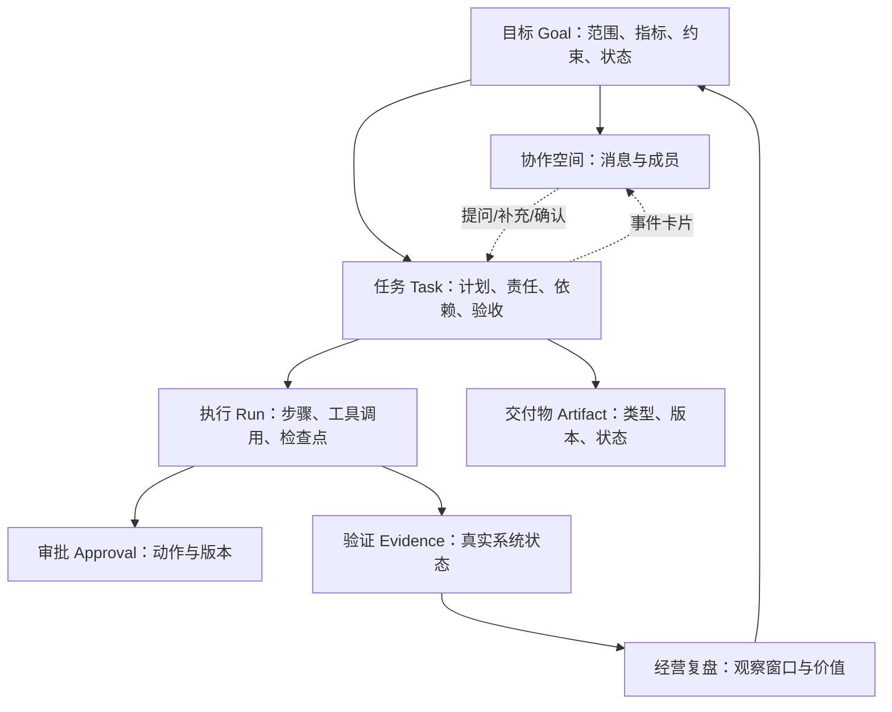

# 产品覆盖评审与设计建议：对照慕雅居 V2.0

评审日期：2026-11-05（北京时间）

依据：用户上传《慕雅居AI电商数字员工解决方案_V2.0.md》完整正文；当前 public/app.js、public/index.html、src/engine.js、src/chat.js、src/server.js。此轮为文档和代码静态评审，不把历史测试通过等同于业务验收。本文件为建议，不改动应用功能，也不将方案中的规划内容视为已确认的实施承诺。

## 1. 核心结论

当前是可交互的目标协作与群聊原型，尚未实现自主经营产品。八条业务闭环均未形成真实系统端到端闭环。可以保留已完成的创建入口、选人、群聊、@、暂停、建议预览与下载，但下一轮优先修正业务对象及状态关联，之后再扩展业务场景。

方案开头明确：12 类岗位和能力清单是目标蓝图，并非全部首期建设。应区分总体架构覆盖、UI 场景覆盖和真实业务能力覆盖，不能按按钮数量或 Agent 名称计算功能完成率。

## 2. 按八个产品模块核查

| 方案模块 / 对应章节 | 当前已存在 | 主要缺口 | 判断 |
| --- | --- | --- | --- |
| 数字员工管理 / 6.2 | 四个固定专长角色展示；建群勾选成员 | 岗位与实例、负责人、目标、店铺/SKU范围、权限、模型/Skill、触发器和运行配置 | 角色选择的交互雏形 |
| 自主经营任务 / 6.3 | 旧任务流具备创建、串行演示、失败、取消、确认归档；群聊另有消息队列 | 自动发现、任务依据、价值/风险、依赖、外部等待、效果复盘；群与任务未关联 | 局部原型，关键结构割裂 |
| 商品经营自动化 / 6.1、4.1 | 商品优化模板文字 | 商品池、SPU/SKU事实、选品评分、规格核验、素材工作区、上架/调价/下架、状态回读 | 未形成业务能力 |
| 流量与经营优化 / 4.2 | 经营分析和内容建议模板 | 流量数据、广告预算、促销测算、贡献利润、测试分组、效果验证 | 未形成业务能力 |
| 跨部门协同执行 / 4.3 | 单个人类身份群聊、指定Agent、暂停、建议下载；旧流有审批标记 | 多人身份、部门工单、责任人、截止时间、催办、审批恢复、真实执行和异常补偿 | 群聊交互可用，跨部门执行未实现 |
| Agent能力中心 / 3.3、6.1 | 固定列表、声明式工具名称、演示适配器 | 能力注册、版本、输入输出约束、依赖、权限、测试、调用记录与成本 | 目录雏形；工具名称不等于工具可用 |
| 数据与商品知识 / 7.5 | 集成介绍页、来源为演示的标记 | 商品事实、SKU映射、库存成本、平台数据、证据引用、数据时效和规则版本 | 未接入 |
| 运行管理与风控 / 7.4、7.7 | JSON存储、单进程轮询、旧任务8轮上限、群队列24项上限 | 身份权限、L1–L5策略、预算和价格约束、幂等、持久工作流、故障恢复、审计和模型成本 | 演示运行基础，不是生产运行管理 |

## 3. 八条业务闭环核查

| 闭环 | 目前对应片段 | 要构成闭环还缺什么 |
| --- | --- | --- |
| A 新品机会与上新 | 商品/内容建议 | 机会来源、选品/利润评分、供货与规格校验、素材、授权上架、平台状态核验、测款与复盘 |
| B 在售经营优化 | 泛化经营诊断文本 | SKU指标、异常归因、优化方案、受控动作、观察窗口和利润评估 |
| C 异常与协同 | 群聊、暂停 | 事件触发、工单和负责人、等待条件、超时、处置、回读与恢复 |
| D 平台活动 | 内容营销话题 | 活动资格、促销叠加、利润与库存校验、报名状态、活动复盘 |
| E 库存履约 | 无专用场景 | 可售/在途库存、供应周期、补货工单、物流事件和验收 |
| F 客户反馈改进 | 客服建议模板 | 咨询/评价/退款事实、规格问题聚类、商品整改、知识更新与效果追踪 |
| G 多店铺复制 | 无专用场景 | 店铺与平台映射、策略适配、授权复制、目标店铺结果验证 |
| H 平台规则健康 | 无专用场景 | 通知与规则版本、影响商品定位、整改任务、状态巡检 |

四个演示 Agent 只是粗粒度交互角色；不应表述为已覆盖方案中的四个完整岗位，更不等于覆盖其下全部专业能力。

## 4. 当前必须修正的产品结构问题

### 4.1 “新建目标”目前实际上只建群

public/app.js 的 task-form 提交调用 createGroup，createGroup 访问 POST /api/rooms；没有创建独立 Goal 对象、关联 Task 或验收指标。房间的 goal 只是文本。

后果：用户认为建立了一个可追踪目标，系统只有会话标题，没有目标完成/失败、责任范围、业务结果或周期性运行的表达。

建议：保留“新建目标”主入口。统一创建 Goal，再关联协作空间和执行任务；页面名称与真实对象一致。

### 4.2 任务、群聊和交付物是两套数据

src/server.js 分别保存 tasks.json 与 rooms.json，无 goalId/taskId 外键。tasksView 只读取 state.tasks；artifactsView 只读取 tasks 内产物。群内成果在 rooms 内，因此总交付物页可能为空，而群里已有多份成果。

旧任务的 decide 审批仅更改旧 task 状态，不影响 room 队列。群暂停也只暂停回复，不表示已暂停业务写操作。

建议：同一个 taskId / artifactId / approvalId 出现在群消息、任务看板与交付物页。群只是协作上下文，不能替代任务状态。

### 4.3 讨论、计划、执行与完成混在一起

当前 sendMessage 默认给全部群内 Agent 排队，tickRoom 将每条回复都生成一个建议成果。没有主 Agent 判断“这是补充背景、提问、改约束还是要求执行”。重复发言容易造成重复建议。

建议默认由协调者判断是否需要回复、谁回复、是否产生任务。@ 指定成员仍保留。人类可以随时说话，但普通消息不应默默触发真实发布、调价或预算动作。

“回复结束”“产物准备好”“平台动作验证成功”“经营效果达到目标”应有不同状态。

### 4.4 缺少五金卫浴的业务对象

当前没有店铺、SKU、规格参数、成本、库存、适配事实和数据出处。对角阀、地漏、软管等，尺寸、接口、材质、安装条件不可由文本生成代替核验。

建议围绕商品事实卡建模，缺项可见、来源可追溯、有更新时间与确认人。数据不足进入“等待资料”，不伪造可发布状态。

### 4.5 岗位和能力被合并成同一层

方案 3.1、3.4 和附录A区分岗位数字员工与专业 Agent/Skill/工具。目前用户直接勾选四个 Agent，无法表达谁负责业务结果、谁仅提供某项能力。

建议保留 Agent 选择，以满足当前用户交互偏好；增加负责数字员工与推荐团队，专业 Agent 放在可展开的高级选择中，显示能力用途、必要输入和可用状态。业务人员无需从上百能力里猜选。

### 4.6 缺少主动发现与持续经营入口

目前每个工作从用户输入开始。方案 6.3、7.2 明确要求目标差距、业务事件、外部机会触发工作。

建议区分一次性目标与持续经营目标；提供“AI发现的机会/异常”收件箱、触发来源与证据。先做可审阅的事件样本 UI，真实数据未接入时明确标注。

## 5. 推荐产品信息架构

保留“新建目标”为全局主操作。建议业务侧常驻导航：

1. 经营总览：目标、利润、有效SKU、上新效率、异常、人工介入与AI价值，直接跳到产生该结果的任务。
2. 协同工作台：目标下的多人/AI讨论；同一工作区可切换讨论、任务、交付物、复盘。
3. 任务中心：自动/人工任务、待我审批、等待资料、协同待办、异常恢复，按店铺和SKU筛选。
4. 商品与知识：商品事实主档、素材、成本库存、平台规则和资料引用；复用ERP权威数据。
5. 数字员工：按职责的岗位配置和运行状态，专业能力作为下一级。
6. 管理设置：模型、Agent/Skill、系统连接、权限和运行审计，根据角色逐级展开。

这是建议导航，不是要求把方案八个中心一比一变成八个一级菜单。平台/店铺/SKU是作用范围，不是复制一套机器人组织的理由。

## 6. 目标创建交互

继续保留自然语言输入和 Agent 选择，采用渐进展开：

- 输入“想完成什么”，可选任务模板和一次性/持续经营类型。
- 系统解析后展示目标确认卡：平台/店铺、商品范围、预期结果、期限或观察窗口。
- 显示推荐负责岗位与协作成员，用户可以增删 Agent。
- 显示数据准备度与执行授权：只做分析、准备草案、授权范围内执行、特定动作审批。
- 缺失重要信息时追问或标记待补齐；不将所有字段变为初始必填长表单。
- 创建后产生同一 Goal ID，进入协作空间；任务中心立即可见相关计划。

持续经营目标再展开巡检频率、触发条件、资源上限、暂停/恢复和结束条件。

## 7. 群聊与结构化工作区如何共存

用户需要群聊，方案 6.4 要求结构化任务承载业务。这两者可以同时满足：聊天是可参与的入口，任务与经营状态是底层事实。

建议布局：左侧目标/会话列表；中间“讨论｜任务｜交付物｜复盘”；右侧当前店铺/SKU、目标进度、关键约束、成员、阻塞和待审批事项。窄屏将右侧内容变为可访问的标签页/抽屉。

群内消息除自然语言外，还应支持：

| 卡片 | 必须显示的内容 | 操作 |
| --- | --- | --- |
| 机会发现 | 来源、观测时间、关联SKU、推断和不确定性 | 纳入计划/忽略并说明 |
| 任务计划 | 负责岗位、依赖、产物、完成标准 | 确认/修改 |
| 缺少资料 | 缺失字段、所需来源、责任人 | 补充/转交 |
| 执行审批 | 精确动作、店铺/SKU、变更前后、预算/利润影响、版本 | 批准/拒绝/修改 |
| 执行结果 | 已提交/待平台处理/核验成功、回读时间、证据 | 查看/重试/升级 |
| 结果复盘 | 观察窗口、基线、变化、费用、是否达到标准 | 继续优化/结束 |

重要约束变更以卡片确认并升级计划版本。审批绑定该版本，变更后失效或重新确认。聊天中的“好的”不能无歧义地代表任意写操作授权。

## 8. 目标对象与数据关系建议

同一目标可以包含多个任务、多个执行尝试；群聊默认与目标关联，但目标不会因为群里暂时没人说话就结束。所有视图复用同一对象，不复制状态。

## 9. 与单 Agent + Loop 的兼容方式

保留统一运行时和单个任务/目标的主协调决策者，不等于全企业只有一个全局串行队列，也不等于所有岗位共享一个无边界对话历史。

岗位数字员工保存职责、目标、权限和可用能力；调度器从事件唤醒具体任务，主协调者调用专业能力并消费结构化结果。遇到等待保存检查点，收到对应事件再恢复。不同目标可隔离运行，在同一SKU写入处控制冲突。

群里可以显示多位数字员工和专业Agent的发言，但是否发言、调用哪个工具、是否重试，由任务状态和调度策略决定。运营风控不能仅是群里一个会说“请注意风险”的角色；权限和数值边界需要执行网关强制校验。

## 10. 下一版建议优先级

### P0：先修结构与一条贯通原型

- 新建目标同时关联目标、群聊与任务；统一交付物查询和审批归属。
- 增加目标卡、平台/店铺/SKU范围与数据准备度。
- 在群内加入计划、缺失资料、审批、执行结果卡，而不只是机器人回复。
- 用一个已确认商品池，设计完整新品经营样例；采用演示数据时逐处注明模拟来源和动作。

### P1：做与方案一致的PoC

按方案 9.3：可用数据主动发现机会 → 利润与供货判断 → 商品资料准备 → 授权上架与回读 → 至少一种真实经营调整 → 观察复盘并产生下一项任务。平台广告写权限缺失时明确保留人工执行，不把它标为自动化完成。

关键前置：试点平台/店铺授权、SKU映射、权威规格、成本库存、可执行接口和利润口径。未就绪时只能验收产品原型，不声称PoC完成。

### P2：逐步扩展

经营异常、库存协同、客户反馈改进；再按数据成熟度扩展活动、投放和跨店复制。岗位目录可以预留12类，但不一次性实现全部专业能力或十二套独立运行系统。

## 11. 一条下一版可验收的设计样例

演示假设：一个已授权试点店铺、现有货源的角阀SKU、完整参数来源。

1. 机会卡显示观测数据和来源，用户看到它为何被提出。
2. 目标确认卡明确店铺、SKU、预计产物和授权边界。
3. 选品任务显示成本、费用和预计贡献利润；无法核算时阻塞并请求资料。
4. 商品管理核验材质、接口、尺寸、库存；内容能力生成文案/素材草案。
5. 群内展示可编辑的商品变更卡和审批卡，审批绑定版本。
6. 执行卡区分“已提交”和“平台已回读验证”，失败进入明确恢复状态。
7. 经营调整动作记录权限与参数；缺权限时创建人工待办。
8. 观察窗口结束后，用可追溯的经营数据复盘，判断继续优化或结束。

设计验收：群聊、任务看板、商品页、审批记录和交付物页看到同一对象与状态；没有数据就显示缺口，没有平台核验就不显示成功，没有经营观察就不显示利润提升。

## 12. 本轮建议不做的事

不继续只换皮肤；不通过把四个Agent改成十二个名字来声称补齐业务；不取消用户要的群聊；不强制把方案能力目录全部变成首期功能；不承诺文档的参考工期和经营收益。下一轮工作的核心是统一对象、跑通真实可解释的业务链路。
